# Database Design — Lead OS

**Engine:** PostgreSQL 16 · **Access:** Prisma 6 (+ typed raw SQL for analytics) ·
Traces to: `FR-TEN-4`, `FR-LEAD-*`, `FR-DUP-*`, `FR-TL-*`, `NFR-SCALE-3`, `NFR-PERF-3`

---

## 1. Conventions (apply to every table)

| Rule              | Detail                                                                                                                                                                                                                                              |
| ----------------- | --------------------------------------------------------------------------------------------------------------------------------------------------------------------------------------------------------------------------------------------------- |
| Primary key       | `id UUID` generated as **UUIDv7** in the app (time-ordered ⇒ index locality, no enumerable ints, safe for distributed/offline generation)                                                                                                           |
| Tenant column     | `organization_id UUID NOT NULL` on **every** tenant-scoped table                                                                                                                                                                                    |
| Tenant uniqueness | `UNIQUE (organization_id, id)` on every tenant table — the anchor for composite FKs                                                                                                                                                                 |
| Composite FKs     | Child references use `(organization_id, parent_id) → parent(organization_id, id)`; cross-tenant references become impossible (`FR-TEN-4`)                                                                                                           |
| Timestamps        | `created_at timestamptz NOT NULL DEFAULT now()`, `updated_at timestamptz NOT NULL` (trigger-maintained); business time is always `timestamptz` (UTC stored, org timezone for display/working-hours logic)                                           |
| Soft delete       | `deleted_at timestamptz NULL` on business data (leads, customers, tasks, deals, notes, documents, forms, websites, workflows, users). Partial indexes `WHERE deleted_at IS NULL`. Hard delete only via retention purge or DSR (`FR-PRV-3`, Rule 15) |
| Actor columns     | `created_by_id`, `updated_by_id` (nullable — system/automation writes are `NULL` + `source` enum)                                                                                                                                                   |
| Money             | `amount_minor BIGINT` + `currency CHAR(3)`. **No floats for money, ever**                                                                                                                                                                           |
| Phones            | `phone_e164 VARCHAR(20)` (normalized, indexed) + `phone_raw VARCHAR(32)` (as received)                                                                                                                                                              |
| Enums             | Postgres enums **only** for developer-owned, code-branching values (e.g. `task_status`). Anything a tenant can rename/extend is a **table** (statuses, sources, lost reasons, task types, outcomes, reschedule reasons) — Rules 5–8                 |
| JSONB             | For open-ended structures: custom field values, payloads, configs, metadata. Always validated in the app against a stored schema; never used to dodge modelling a real relationship                                                                 |
| Naming            | `snake_case`, plural tables, `<table>_<cols>_idx` / `_uq` / `_fk`, `_at` for timestamps, `_id` for keys                                                                                                                                             |
| Index prefix      | Every tenant-table index starts with `organization_id` (except global-unique lookups such as `provider_message_id`)                                                                                                                                 |
| Migrations        | Forward-only, reviewed SQL; additive then backfill then switch; no destructive change without a written rollback note                                                                                                                               |

---

## 2. Entity-relationship overview

```mermaid
erDiagram
  PLANS ||--o{ SUBSCRIPTIONS : "sold as"
  ORGANIZATIONS ||--|| SUBSCRIPTIONS : has
  ORGANIZATIONS ||--o{ BRANCHES : has
  ORGANIZATIONS ||--o{ TEAMS : has
  ORGANIZATIONS ||--o{ MEMBERSHIPS : has
  USERS ||--o{ MEMBERSHIPS : "joins via"
  ROLES ||--o{ USER_ROLES : grants
  USERS ||--o{ USER_ROLES : has
  ROLES ||--o{ ROLE_PERMISSIONS : includes
  PERMISSIONS ||--o{ ROLE_PERMISSIONS : "listed in"

  ORGANIZATIONS ||--o{ LEADS : owns
  LEAD_SOURCES ||--o{ LEADS : "origin of"
  CAMPAIGNS ||--o{ LEADS : "attributed to"
  PIPELINES ||--o{ PIPELINE_STAGES : has
  PIPELINE_STAGES ||--o{ LEADS : "current stage"
  LEAD_STATUSES ||--o{ LEADS : "current status"
  USERS ||--o{ LEADS : "assigned to"

  LEADS ||--o{ LEAD_TOUCHPOINTS : accumulates
  LEADS ||--o{ LEAD_ASSIGNMENTS : history
  LEADS ||--o{ LEAD_STAGE_HISTORY : history
  LEADS ||--o{ ACTIVITIES : timeline
  LEADS ||--o{ TASKS : "next actions"
  LEADS ||--o{ NOTES : has
  LEADS ||--o{ DOCUMENTS : has
  LEADS ||--o{ CONVERSATIONS : "talks in"
  LEADS ||--o{ CALLS : has
  LEADS ||--o{ DEALS : "may become"
  LEADS ||--o{ CONSENTS : grants
  LEADS ||--o{ LEAD_DUPLICATES : "flagged with"
  LEADS ||--o| CUSTOMERS : "converts to"

  CONVERSATIONS ||--o{ MESSAGES : contains
  WHATSAPP_NUMBERS ||--o{ CONVERSATIONS : "hosted on"
  WHATSAPP_ACCOUNTS ||--o{ WHATSAPP_NUMBERS : has
  WHATSAPP_TEMPLATES ||--o{ MESSAGES : "rendered into"
  MESSAGES ||--o{ MESSAGE_STATUS_EVENTS : tracked
  MESSAGES ||--o{ MESSAGE_MEDIA : carries

  DEALS ||--o{ DEAL_ITEMS : "lines"
  DEALS ||--o{ QUOTATIONS : quoted
  DEALS ||--o{ PAYMENTS : "paid by"
  CUSTOMERS ||--o{ DEALS : buys

  FORMS ||--o{ FORM_FIELDS : has
  FORMS ||--o{ FORM_SUBMISSIONS : receives
  FORM_SUBMISSIONS ||--o| LEADS : creates
  INBOUND_PAYLOADS ||--o| LEADS : "may create"

  WORKFLOWS ||--o{ WORKFLOW_VERSIONS : versioned
  WORKFLOW_VERSIONS ||--o{ WORKFLOW_STEPS : contains
  WORKFLOW_VERSIONS ||--o{ AUTOMATION_RUNS : executes
  AUTOMATION_RUNS ||--o{ AUTOMATION_RUN_STEPS : logs

  WEBSITES ||--o{ WEBSITE_PAGES : has
  WEBSITES ||--o{ WEBSITE_DOMAINS : "served at"
  WEBSITES ||--o{ WEBSITE_EVENTS : generates
  ANALYTICS_VISITORS ||--o{ ANALYTICS_SESSIONS : has
  ANALYTICS_SESSIONS ||--o{ WEBSITE_EVENTS : contains
  ANALYTICS_VISITORS ||--o{ VISITOR_IDENTITIES : "stitched to"
  VISITOR_IDENTITIES }o--|| LEADS : identifies

  AD_ACCOUNTS ||--o{ CAMPAIGNS : syncs
  CAMPAIGNS ||--o{ AD_ENTITIES : "ad sets/ads"
  CAMPAIGNS ||--o{ CAMPAIGN_DAILY_METRICS : "spend/impr/clicks"
  LEAD_TOUCHPOINTS }o--|| CAMPAIGNS : "attributes to"

  INTEGRATION_CONNECTIONS ||--o{ PROVIDER_EVENTS : receives
  WEBHOOK_ENDPOINTS ||--o{ WEBHOOK_DELIVERIES : sends
  WEBHOOK_DELIVERIES ||--o{ WEBHOOK_ATTEMPTS : retries
  OUTBOX_EVENTS }o--|| ORGANIZATIONS : "emitted by"
```



Full table list follows, grouped by module. Column lists are abbreviated to keys, discriminators and
anything architecturally meaningful; exhaustive columns live in `packages/db/prisma/schema/*.prisma`
once Phase 1 begins.

---

## 3. Platform (non-tenant) tables

These have **no** `organization_id` and are unreachable from tenant routes.

| Table                                | Purpose                          | Key columns / notes                                                                                                     |
| ------------------------------------ | -------------------------------- | ----------------------------------------------------------------------------------------------------------------------- |
| `plans`                              | SaaS plans                       | `code UQ`, name, description, `interval (month                                                                          | year)`, `price_minor`, `currency`, `trial_days`, `is_public`, `sort_order`, `is_active` |
| `plan_features`                      | Limits & flags per plan          | `(plan_id, feature_key) UQ`, `limit_value BIGINT NULL` (NULL = unlimited), `is_enabled BOOL`, `overage_policy`          |
| `features`                           | Catalogue of entitlement keys    | `key UQ`, name, `unit (count                                                                                            | per_month                                                                               | bytes      | bool)`, description — Super Admin editable (`FR-BIL-2`) |
| `platform_settings`                  | Singleton-ish config             | `key UQ`, `value JSONB`, `is_secret`                                                                                    |
| `platform_users`                     | Platform staff                   | Separate from tenant `users`; own MFA requirement                                                                       |
| `industry_templates`                 | Onboarding seeds                 | `code UQ`, industry, `definition JSONB` (fields, pipeline, statuses, sources, views, automations, WA template drafts)   |
| `website_templates`                  | Site templates                   | `code UQ`, industry, thumbnail, `schema JSONB`, `is_active`                                                             |
| `service_packages`                   | Marketing/dev services catalogue | `code`, type (`seo                                                                                                      | meta_ads                                                                                | google_ads | website                                                 | landing_page | content | social`), `price_minor`, `billing_cycle`, `deliverables JSONB` |
| `coupons`                            | Discounts                        | code, type, value, limits, validity                                                                                     |
| `platform_audit_logs`                | Platform-actor audit             | append-only                                                                                                             |
| `impersonation_sessions`             | Support impersonation            | `platform_user_id`, `organization_id`, `target_user_id`, reason, `started_at`, `ended_at`, `actions_count` (`FR-TEN-7`) |
| `support_tickets`, `ticket_messages` | Support                          | org, reporter, status, priority, SLA                                                                                    |
| `feature_flags`                      | Platform/tenant rollout          | `key`, `scope (global                                                                                                   | org)`, `rules JSONB`, percentage rollout                                                |
| `job_failures`                       | DLQ mirror for Super Admin       | queue, job name, payload (redacted), error, attempts, `retried_at` (`FR-SA-4`)                                          |
| `system_health_checks`               | Probe results                    | component, status, latency_ms, checked_at, detail                                                                       |

---

## 4. Organization, identity & access

| Table                                    | Purpose                                                | Key columns / notes                                                                                                                                                                                                                                                                           |
| ---------------------------------------- | ------------------------------------------------------ | --------------------------------------------------------------------------------------------------------------------------------------------------------------------------------------------------------------------------------------------------------------------------------------------- |
| `organizations`                          | Tenant root                                            | `slug UQ`, name, legal_name, industry, `country`, `timezone`, `default_currency`, `default_phone_country`, `status (trialing                                                                                                                                                                  | active | past_due                                                                       | grace                                   | suspended                                                                                                                                                                                                                                                                                                                                                                                               | cancelled)`, `public_key UQ`, `logo_url`, `settings JSONB`, `onboarding_state JSONB`, `deleted_at` |
| `branches`                               | Locations                                              | org, name, code, address, timezone, `is_default`                                                                                                                                                                                                                                              |
| `teams`                                  | Groups                                                 | org, name, `manager_id`, `branch_id`                                                                                                                                                                                                                                                          |
| `team_members`                           | Membership                                             | `(organization_id, team_id, user_id) UQ`, `is_lead`                                                                                                                                                                                                                                           |
| `users`                                  | **Global identity** (platform table, ADR-0012)         | `email` (`UNIQUE (organization_id, lower(email))`), `password_hash` (Argon2id), name, `phone_e164`, avatar, `status (invited                                                                                                                                                                  | active | disabled)`, `timezone`, `locale`, `last_login_at`, `mfa_enabled`, `deleted_at` |
| `memberships`                            | **Tenant anchor for a person** (multi-org, `FR-IAM-6`) | `(organization_id, user_id) UQ`, `(organization_id, id) UQ`, status, `default_branch_id`, `is_owner`, `joined_at`. Every tenant row referencing a person references **this** by `(organization_id, user_id)`, so work cannot be assigned to a non-member — the database rejects it (ADR-0012) |
| `roles`                                  | Per-org roles                                          | `(organization_id, code) UQ`, name, `is_system`, `is_editable`, description                                                                                                                                                                                                                   |
| `permissions`                            | Catalogue (platform-level)                             | `key UQ` e.g. `lead:read`, `module`, `description`, `supports_scope BOOL`                                                                                                                                                                                                                     |
| `role_permissions`                       | Grants                                                 | `(role_id, permission_key) UQ`, `scope (own                                                                                                                                                                                                                                                   | team   | branch                                                                         | organization)` (`FR-IAM-4`)             |
| `user_roles`                             | Assignment                                             | `(organization_id, user_id, role_id) UQ`                                                                                                                                                                                                                                                      |
| `invitations`                            | Onboarding                                             | email, role, team, branch, `token_hash`, `expires_at`, `accepted_at`                                                                                                                                                                                                                          |
| `sessions`                               | Refresh sessions                                       | `user_id`, `refresh_token_hash`, `family_id`, `prev_id` (rotation/reuse detection), device, ip, ua, `expires_at`, `revoked_at`                                                                                                                                                                |
| `password_resets`, `email_verifications` | Token flows                                            | `token_hash`, `expires_at`, `used_at`                                                                                                                                                                                                                                                         |
| `mfa_secrets`, `mfa_recovery_codes`      | TOTP                                                   | encrypted secret, `code_hash`                                                                                                                                                                                                                                                                 |
| `working_hours`                          | Per org/branch/user                                    | `scope`, `owner_id`, `day_of_week`, `start_time`, `end_time`, timezone                                                                                                                                                                                                                        |
| `holidays`                               | Calendar                                               | org/branch, date, name, `is_working`                                                                                                                                                                                                                                                          |
| `user_availability`                      | Leave/status                                           | user, `state (available                                                                                                                                                                                                                                                                       | busy   | leave                                                                          | offline)`, from/to, reason (`FR-IAM-8`) |
| `audit_logs`                             | Tenant audit, append-only                              | org, `actor_type (user                                                                                                                                                                                                                                                                        | system | automation                                                                     | platform                                | api_key)`, actor_id, action, `resource_type`, `resource_id`, `before JSONB`, `after JSONB`, ip, user_agent, request_id, `created_at`. Append-only **enforced by trigger**: UPDATE always rejected, DELETE only inside a transaction setting `app.audit_purge='on'`(the retention/DSR path,`withAuditPurge()`). Organization FK is `RESTRICT` so no cascade can erase the trail (`FR-AUD-2`, `FR-PRV-3`) |

---

## 5. Custom fields (the metadata engine)

**Decision (ADR-0005): JSONB-on-row, driven by a definition table.** Rejected: per-tenant columns
(violates Rule 5, unbounded DDL), classic EAV (one join per displayed field; 30-field list view =
unusable), separate table per type (same join problem).

| Table                      | Purpose       | Key columns                                                         |
| -------------------------- | ------------- | ------------------------------------------------------------------- |
| `custom_field_sections`    | UI grouping   | org, `entity_type`, name, sort_order, `collapsed_by_default`        |
| `custom_field_definitions` | The metadata  | org, `entity_type (lead                                             | customer | deal | task | conversation)`, `key` (`UNIQUE (organization_id, entity_type, key)`, immutable after create), `label`, `type`, `placeholder`, `help_text`, `is_required`, `default_value JSONB`, `validation JSONB`(min/max/regex/precision/maxLength/fileTypes/maxSizeKb),`section_id`, `sort_order`, `visibility JSONB`(role/stage conditions),`show_in_list`, `is_searchable`, `is_filterable`, `is_indexed`, `is_pii`, `is_active`, `deleted_at` |
| `custom_field_options`     | Choice values | `(definition_id, value) UQ`, label, colour, sort_order, `is_active` |

Values live on the owning row:

```sql
ALTER TABLE leads ADD COLUMN custom_values     JSONB NOT NULL DEFAULT '{}'::jsonb;
ALTER TABLE leads ADD COLUMN custom_search_text TEXT;  -- concatenated searchable values

CREATE INDEX leads_custom_values_gin
  ON leads USING GIN (custom_values jsonb_path_ops);

-- Hot-path fields get a real index, created by a controlled admin job when
-- is_indexed = true on the definition (expression index, no schema change to the table shape):
CREATE INDEX leads_cv_budget_idx
  ON leads ((custom_values->>'budget')) WHERE deleted_at IS NULL;
```

Rules:

- The API **never** trusts client-sent keys: the values object is validated against active
  definitions; unknown keys are rejected (or quarantined on ingestion, `FR-CAP-5`).
- Types are stored canonically inside JSONB: numbers as JSON numbers, dates as ISO-8601 strings,
  currency as `{ "amount_minor": 500000000, "currency": "INR" }`, files as `{ documentId, name, size, mime }`.
- `is_indexed = true` triggers an admin job that creates the expression index concurrently; the
  definition records the index name so it can be dropped on deactivation. Filterable-but-unindexed
  fields still work via the GIN index.
- Deleting a definition is a soft delete; values are retained until retention purge so history and
  audit remain truthful.
- `custom_search_text` is maintained on write and included in the search `tsvector`.

---

## 6. Leads & CRM core

### 6.1 `leads`

```
id, organization_id, branch_id?, team_id?, assigned_user_id?,
first_name, last_name, full_name (application-maintained*), company, job_title?,
phone_e164?, phone_raw?, whatsapp_e164?, email?,
city?, state?, country?, postal_code?, timezone?,
lead_source_id?, campaign_id?, ad_entity_id?, form_id?, website_id?, landing_page_url?,
utm JSONB,                       -- source/medium/campaign/term/content/gclid/fbclid
status_id, pipeline_id, stage_id, priority (enum: low|medium|high|urgent),
score INT DEFAULT 0, score_band?,
value_minor BIGINT?, currency CHAR(3)?,
custom_values JSONB, custom_search_text TEXT, search_vector tsvector,
first_contacted_at?, last_contacted_at?, last_activity_at?,
next_action_at?, next_action_task_id?,       -- denormalized for the Today view
open_tasks_count INT, reschedule_count INT, touch_count INT,
sla_first_response_due_at?, sla_first_response_at?, sla_state (ok|at_risk|breached),
converted_at?, customer_id?, lost_reason_id?, lost_note?,
is_duplicate_of_id?, merged_into_id?,
consent_whatsapp BOOL, consent_email BOOL, consent_calls BOOL,
created_by_id?, created_via (manual|form|api|webhook|import|whatsapp|meta_ads|google_ads|website),
created_at, updated_at, deleted_at
```

\* _Deviation:_ `full_name` is maintained by the application rather than being a generated column, for
the same reason `updated_at` is not a trigger (§16.10) — Prisma sends every column it knows about and
would fight a generated one. It is derived in one place (`buildFullName`) and falls back to the company,
the email, then the phone number, because an unnamed enquiry from a phone number is still a lead.

**Columns deferred to the step that brings their table.** `customer_id`, `campaign_id`, `ad_entity_id`,
`form_id`, `website_id`, `next_action_task_id`, `is_duplicate_of_id`, `merged_into_id`,
`sla_first_response_*` and `sla_state` are absent from the Phase 2 step-1 schema rather than present as
unconstrained uuids: a nullable id with no foreign key is a column nothing can trust. They arrive with
`customers`, `campaigns`, `forms`, `websites`, `tasks`, `lead_duplicates` and `sla_policies`
respectively. `score` and `score_band` **are** present, because the columns are scalars and the scoring
engine writes them without a new table.

Indexes (all `WHERE deleted_at IS NULL` where applicable):

```sql
UNIQUE (organization_id, id)                                    -- composite-FK anchor
(organization_id, created_at DESC)                              -- default list
(organization_id, assigned_user_id, next_action_at)             -- executive Today view
(organization_id, stage_id, updated_at DESC)                    -- kanban columns
(organization_id, status_id)
(organization_id, phone_e164)          -- duplicate detection + search
(organization_id, whatsapp_e164)
(organization_id, lower(email))
(organization_id, lead_source_id, created_at)                   -- source reports
(organization_id, campaign_id, created_at)                      -- campaign reports
(organization_id, score DESC)
(organization_id, sla_state, sla_first_response_due_at)         -- SLA board
(organization_id, last_activity_at)                             -- ageing / recycling
GIN (search_vector)                                             -- global search
GIN (custom_values jsonb_path_ops)
Partial: (organization_id, assigned_user_id) WHERE next_action_at IS NULL AND status open
                                                                -- "no next action" detection
```

### 6.2 Supporting lead tables

| Table                                       | Purpose                 | Notes                                                                                                                                                                                                                                                                                                         |
| ------------------------------------------- | ----------------------- | ------------------------------------------------------------------------------------------------------------------------------------------------------------------------------------------------------------------------------------------------------------------------------------------------------------- |
| `lead_statuses`                             | Tenant-defined statuses | org, name, colour, `category (open                                                                                                                                                                                                                                                                            | won    | lost                                        | invalid)`, sort_order, `is_default` |
| `lead_sources`                              | Tenant-defined sources  | org, name, `type`, `integration_connection_id?`, `cost_model`, `is_active`; reports join cost & revenue (`FR-LEAD-7`, §8 of PRD)                                                                                                                                                                              |
| `lost_reasons`                              | Tenant-defined          | org, name, sort_order, `requires_note`                                                                                                                                                                                                                                                                        |
| `tags`, `lead_tags`                         | Free tagging            | `(organization_id, lead_id, tag_id) UQ`                                                                                                                                                                                                                                                                       |
| `lead_touchpoints`                          | **Attribution spine**   | org, lead_id, `sequence INT`, `occurred_at`, `channel`, `lead_source_id?`, `campaign_id?`, `ad_entity_id?`, `form_id?`, `website_id?`, `landing_page_url?`, `utm JSONB`, `session_id?`, `cost_attributable BOOL`, `metadata JSONB`. **Never overwritten** — a second capture appends (`FR-DUP-3`, `FR-ATT-1`) |
| `lead_assignments`                          | Assignment history      | org, lead_id, `from_user_id?`, `to_user_id?`, `to_team_id?`, `assigned_by_id?`, `assignment_rule_id?`, `reason`, `created_at` (`FR-ASG-5`)                                                                                                                                                                    |
| `lead_status_history`, `lead_stage_history` | Transitions             | from, to, `changed_by_id?`, `duration_seconds` (time spent in previous), `created_at`                                                                                                                                                                                                                         |
| `lead_score_events`                         | Score explainability    | rule_id, delta, reason, `score_after`, created_at (`FR-SCR-2`)                                                                                                                                                                                                                                                |
| `lead_duplicates`                           | Detected candidates     | org, `lead_id`, `duplicate_lead_id`, `rule_id`, `match_fields JSONB`, `confidence`, `status (open                                                                                                                                                                                                             | merged | dismissed)`                                 |
| `lead_merges`                               | Merge record            | org, `surviving_lead_id`, `merged_lead_id`, `field_choices JSONB`, `performed_by_id`, `undone_at?`, snapshot for reversal (`FR-DUP-4`)                                                                                                                                                                        |
| `duplicate_rules`                           | Matching config         | org, name, `match_on JSONB` (fields/composites), `lookback_days`, `action`, `priority`, `is_active`                                                                                                                                                                                                           |
| `customers`                                 | Converted               | Moved to [§6.7](#67-customers-and-conversion), with the conversion rules it is inseparable from                                                                                                                                                                                                               |
| `saved_views`                               | Filters/views           | org, owner_id?, `entity_type`, name, `filters JSONB`, `columns JSONB`, `sort JSONB`, `visibility (private                                                                                                                                                                                                     | team   | org)`, `is_default_for_role?` (`FR-VIEW-3`) |

> **Amendment, 2026-09-30 (implementation).** `saved_views` also carries `team_id` and
> `default_for_role_id`. `visibility = 'team'` is meaningless without naming _which_ team, and
> `is_default_for_role` as a boolean cannot say which role — both are foreign keys, composite and
> tenant-scoped like every other reference. Uniqueness is partial rather than absolute: one view name
> per owner, one per name among the views everyone can see, one landing view per role per entity,
> each `WHERE deleted_at IS NULL` so a deleted view's name is reusable.

### 6.3 Pipelines, assignment, scoring

| Table                        | Key columns                                                                                                                                                            |
| ---------------------------- | ---------------------------------------------------------------------------------------------------------------------------------------------------------------------- |
| `pipelines`                  | org, name, `entity_type (lead                                                                                                                                          | deal)`, `is_default`, is_active |
| `pipeline_stages`            | org, pipeline_id, name, colour, `sort_order`, `probability SMALLINT`, `is_won`, `is_lost`, `required_fields JSONB`, `target_duration_hours?`, `automation_hooks JSONB` |
| `assignment_rules`           | org, name, `priority INT`, `is_active`, `strategy (specific_user                                                                                                       | team                            | round_robin | weighted_round_robin | least_open_leads | top_performer)`, `target JSONB`, `respect_working_hours BOOL`, `capacity_cap?`, `fallback JSONB` |
| `assignment_rule_conditions` | rule_id, `field_path`, `operator`, `value JSONB`, `group_index` (AND within group, OR across groups)                                                                   |
| `assignment_pool_members`    | rule_id, user_id, `weight`, `is_active`                                                                                                                                |
| `round_robin_state`          | `(organization_id, rule_id) UQ`, `cursor_index`, `last_assigned_user_id`, `updated_at` (Redis is the fast path; this row is the durable truth)                         |
| `scoring_rules`              | org, name, `trigger_event`, `conditions JSONB`, `points INT`, `max_applications?`, `decay JSONB?`, is_active                                                           |
| `score_bands`                | org, name, `min_score`, `max_score`, colour                                                                                                                            |

> **Amendment, 2026-10-05 (implementation).** Postgres indexes the **referenced** side of a foreign
> key, never the referencing side. `leads.is_duplicate_of_id` and `leads.merged_into_id` point back
> at `leads` with `ON DELETE RESTRICT`, so before `leads_duplicate_of` and `leads_merged_into`
> existed, deleting a lead scanned the whole `leads` table twice — once per constraint. Invisible at
> demo scale; on the 100 k-lead fixture in `packages/db/perf` the statement was still running after
> three minutes, and with the indexes it takes five seconds. **Every new FK whose referencing
> columns are not already the prefix of an index needs one**, and a cascade or a retention purge is
> where its absence surfaces.

> **Amendment, 2026-09-30 (implementation).** Three refinements, each forced by a silent failure:
>
> - **Bands are a partition of 0–1000, enforced by an exclusion constraint** (`score_bands_no_overlap`,
>   which needs `btree_gist`). An overlap would make a lead's band depend on evaluation order; a gap
>   would leave a lead with a score and no band, missing from every band-filtered view. The
>   application refuses both with a readable message; the constraint is what holds when two band
>   replacements interleave.
> - **`scoring_rules` ties `decay` to the trigger**: `(trigger_event = 'schedule.decay') = (decay IS
NOT NULL)`. An additive rule on the sweep never fires and a decay spec on `lead.created` is never
>   swept — both are misconfigurations nothing would report.
> - **`lead_score_events` is the authoritative score** ([ADR-0015](./decisions/ADR-0015-score-as-event-sum.md)):
>   `leads.score` caches its sum, idempotency is `UNIQUE (organization_id, lead_id, rule_id,
source_event_id) WHERE source_event_id IS NOT NULL`, and `delta <> 0` keeps rows that changed
>   nothing out of an explanation meant to read as arithmetic.

### 6.4 Tasks, SLA, activities

| Table                | Key columns                                                                                                                                                                                                                                  |
| -------------------- | -------------------------------------------------------------------------------------------------------------------------------------------------------------------------------------------------------------------------------------------- |
| `tasks`              | org, `lead_id?`, `customer_id?`, `deal_id?`, `conversation_id?`, title, description, `task_type_id`, `due_at timestamptz`, `due_date date` + `due_time time` (for org-timezone day grouping), priority, `assigned_user_id`, `status (pending | in_progress                                                                                        | completed                                                                                                        | cancelled | rescheduled)`, `completed_at?`, `outcome_id?`, `completion_note?`, `reminder_offsets JSONB`, `created_via`, `automation_run_id?`, `rescheduled_from_task_id?`, `reschedule_count`, deleted_at |
| `task_types`         | org, name, icon, `default_duration_minutes`, `default_reminder_offsets`, is_active                                                                                                                                                           |
| `task_reschedules`   | org, task_id, `from_due_at`, `to_due_at`, `reason_id`, `reason_note?`, `rescheduled_by_id`, created_at (`FR-TSK-5`)                                                                                                                          |
| `reschedule_reasons` | org, name, sort_order, `requires_note`, is_active (seeded with the brief's list, editable)                                                                                                                                                   |
| `task_reminders`     | task_id, `remind_at`, `channel`, `sent_at?`, `job_id?`                                                                                                                                                                                       |
| `sla_policies`       | org, name, `applies_to JSONB` (source/priority/pipeline/score band), `first_response_minutes`, `next_response_minutes?`, `resolution_minutes?`, `business_hours_only BOOL`, `escalate_to JSONB`, is_active                                   |
| `sla_clocks`         | org, `subject_type (lead                                                                                                                                                                                                                     | conversation                                                                                       | task)`, `subject_id`, `policy_id`, `started_at`, `due_at`, `paused_ms`, `satisfied_at?`, `breached_at?`, `state` |
| `escalations`        | org, subject, `policy_id`, `level`, `notified_user_ids`, `created_at`, `acknowledged_at?`                                                                                                                                                    |
| `activities`         | **Append-only timeline.** org, `lead_id?`, `customer_id?`, `deal_id?`, `conversation_id?`, `type` (see §6.5), `actor_type`, `actor_id?`, `occurred_at timestamptz`, `payload JSONB`, `visibility (all                                        | internal)`, `source_event_id?`(idempotency),`created_at`. **Partitioned monthly by `occurred_at`** |
| `notes`              | org, subject, `body`, `is_internal`, `mentions UUID[]`, author, deleted_at                                                                                                                                                                   |
| `mentions`           | org, note_id/message_id, `mentioned_user_id`, `read_at?`                                                                                                                                                                                     |

> **Amendment, 2026-10-06 (implementation, Phase 3 step 1).** `tasks`, `task_types`,
> `task_outcomes`, `reschedule_reasons`, `task_reschedules` and `task_reminders` are built. Five
> corrections to the rows above; the reasoning is
> [ADR-0022](./decisions/ADR-0022-overdue-is-derived-and-a-reschedule-moves-the-row.md).
>
> - **`task_status` has four values, not five.** `pending | in_progress | completed | cancelled`.
>   `overdue` is derived from the clock (`due_at < now()` on an open task) and would be wrong
>   between a sweep's ticks; `rescheduled` is not a state an open task can be in, because an open
>   task has to stay in "what is due".
> - **`rescheduled_from_task_id` is implemented as `follows_task_id`**, and means something else: a
>   reschedule moves the same row, so the only chain worth storing is the follow-up created at
>   completion pointing back at the task it came out of (`FR-TSK-6`). `reschedule_count` is a cache
>   of `count(task_reschedules)` and the rows are what make it explainable.
> - **`task_outcomes` is a new table** the row list did not name, though §1's enum rule lists
>   "outcomes" among the tenant-owned ones. `tasks.outcome_id` references it: org, name,
>   `is_positive BOOL NULL` (three-way — a no-answer is neither), `requires_note`, `sort_order`,
>   `is_active`, `deleted_at`. `call_outcomes` stays separate, per the ADR.
> - **`task_reminders` has `offset_minutes` and no `job_id`.** A reminder is a row swept every
>   minute, not a delayed job that would have to be cancelled on every reschedule; the offset is
>   kept so the notification can say "due in an hour" rather than only naming a time.
>   `UNIQUE (organization_id, task_id, offset_minutes)` makes rewriting the set an upsert.
> - **`due_date` and `due_time` are NOT NULL and maintained on write**, like `leads.full_name`:
>   "due today" is a question about the workspace's calendar day, and
>   `due_at AT TIME ZONE org.timezone` on every row cannot use an index.
>
> `tasks` also carries `overdue_notified_at`, which is what makes the sweep report a missed
> follow-up once rather than every half hour, and which a reschedule clears. `automation_run_id` is
> deliberately absent until Phase 6 creates `automation_runs` — a column with no table to reference
> is an FK that cannot exist.
>
> **`leads.next_action_task_id` was added** (the row list in §6.2 named it; the column did not
> exist). It is written only by the tasks module, recomputed from the open tasks under the lead's
> row lock, and the lock is taken **before** the task write — inserting a task takes a
> `FOR KEY SHARE` lock on its lead, so asking for `FOR UPDATE` afterwards deadlocks two
> simultaneous creates on one lead.
>
> Hand-written objects: `tasks_has_subject`, `tasks_title_present`,
> `tasks_completed_has_timestamp`, `tasks_cancelled_has_timestamp` (both `CASE`, never
> biconditionals — see the payments amendment), `tasks_completed_has_outcome`,
> `tasks_reminder_offsets_is_array`, `tasks_reschedule_count_non_negative`,
> `tasks_not_own_follow_up`, `task_types_name_present`, `task_types_duration_positive`,
> `task_types_reminder_offsets_is_array`, `task_outcomes_name_present`,
> `reschedule_reasons_name_present`, `task_reschedules_changes_the_time`,
> `task_reschedules_note_present`, `task_reminders_offset_non_negative`, the eleven composite FKs,
> and the partial indexes `tasks_open`, `tasks_open_due_date`, `tasks_overdue_unreported`,
> `tasks_lead_open`, `tasks_live_created_at`, `tasks_follows`, `leads_next_action_task` and
> `task_reminders_pending`. The last two sweep indexes are deliberately **not** prefixed by
> `organization_id`: both sweeps run across tenants, and a leading tenant column would make them
> scan rather than seek.

> **Amendment, 2026-10-07 (implementation, Phase 3 step 2).** `sla_policies`, `sla_clocks` and
> `escalations` are built. The reasoning is
> [ADR-0023](./decisions/ADR-0023-sla-clocks-are-stored-and-escalation-is-a-unique-key.md); the
> corrections to the rows above:
>
> - **`sla_policies` gained `warn_at_percent` and `priority`.** The near-breach `FR-TSK-8` asks for
>   has to be a share of the target somebody can set — 80 % by default — and matching needs an
>   explicit order, which is the `priority` convention [ADR-0014](./decisions/ADR-0014-duplicate-matching.md)
>   set for duplicate rules. `escalate_to` holds `{ permission?, userIds? }`: a **permission**, not a
>   role name, so a workspace that renames its roles keeps working.
> - **`sla_clocks` gained `target`, `warn_at`, `target_minutes`, `warned_at`, `satisfied_by` and a
>   real `lead_id`.** `target` because one subject has several promises (first response, resolution)
>   and the row list implied one clock each. `warn_at` and `target_minutes` are walked through the
>   business calendar at capture and **stored**: the sweep needs one indexed query across every
>   tenant, and a promise recomputed later against an edited calendar would move a deadline already
>   communicated. `lead_id` is a composite FK beside the polymorphic `subject_id`, so "a clock on
>   another tenant's lead" is unrepresentable and the board joins without a union.
> - **`escalations` gained `clock_id`, `reason` and `acknowledged_by_id`**, and
>   `notified_user_ids` is a `UUID[]` rather than a join table — written once, read whole, and
>   nothing queries "every escalation that reached this person".
>   `UNIQUE (organization_id, clock_id, level)` is the "escalate exactly once" guarantee the phase's
>   exit criteria ask for: a database constraint rather than a careful sweep.
> - **`sla_clocks.paused_ms` has no writer yet.** It is for the pause/resume a conversation SLA
>   needs, and `sla_clocks_paused_non_negative` keeps it honest in the meantime. Said out loud
>   rather than left to look implemented.
> - **`working_hours` is now read as a calendar, and a workspace has its own rows.** Provisioning
>   has written the _owner's_ hours since Phase 1; it now also writes workspace-wide rows
>   (`user_id IS NULL, branch_id IS NULL`), and `seedWorkingHours` backfills existing workspaces.
>   Without them the SLA clock falls back to always-open and runs through the night — wrong, and
>   invisibly so. A branch's own rows win over the workspace's.
>
> **`leads.first_contacted_at` and `last_contacted_at` finally have a writer.** They have existed
> since Phase 2 step 1 with none at all, which is the same shape as a money column that reads as
> zero and lies to every report touching it. A completed follow-up writes both, and `first` never
> moves once set while `last` never moves backwards.
>
> Hand-written objects: `sla_policies_name_present`, `sla_policies_first_response_positive`,
> `sla_policies_next_response_positive`, `sla_policies_resolution_positive`,
> `sla_policies_warn_percent_range` (1–99, because 0 % fires at the start and 100 % arrives with the
> breach), `sla_policies_applies_to_is_object`, `sla_policies_escalate_to_is_object`,
> `sla_clocks_lead_subject_has_lead`, `sla_clocks_subject_matches_lead`,
> `sla_clocks_target_minutes_positive`, `sla_clocks_paused_non_negative`,
> `sla_clocks_instants_ordered`, the three `CASE`-shaped state/timestamp checks, the five composite
> FKs, `escalations_level_matches_reason`, `escalations_notified_somebody`,
> `escalations_acknowledged_pair`, and the partial indexes `sla_clocks_awaiting_warning`,
> `sla_clocks_awaiting_breach`, `sla_clocks_open`, `escalations_clock` and
> `escalations_unacknowledged`. The first two are deliberately **not** prefixed by
> `organization_id`: the sweep runs platform-wide, and a leading tenant column would make it scan
> rather than seek.
>
> `escalations_notified_somebody` shipped as `array_length(notified_user_ids, 1) >= 1`, which does
> not do what it reads as — `array_length` on an empty array is **NULL**, and a CHECK evaluating to
> NULL is _satisfied_, so a row claiming somebody was told when nobody was went straight in.
> `20261007103000_escalation_notified_check` corrects it to `cardinality`.

> **Amendment, 2026-10-13 (implementation, Phase 3 step 3 — `/my/today`).** The Today screen stores
> nothing of its own: it reads rows these tables and `leads` already hold, so `schema.prisma` is
> unchanged and nothing was generated — and so there were no spurious DROPs to strip this time.
>
> It added **one hand-written object**, in `20261013143000_phase3_today`:
>
> ```sql
> CREATE INDEX leads_awaiting_first_contact
>   ON leads (organization_id, created_at)
>   WHERE deleted_at IS NULL
>     AND first_contacted_at IS NULL
>     AND converted_at IS NULL
>     AND lost_at IS NULL;
> ```
>
> "Which of the leads I can see has nobody spoken to yet?" — the screen's third section, and the
> question behind every first-response promise in the product. Partial rather than complete because
> the answer is a small, _shrinking_ slice of a large table while the contacted population it would
> otherwise be read past only grows: on the 100 k fixture the section's query is **3.4 ms** with
> this index and **10.7 ms** without. Every predicate in it is also in the query, which is what
> lets the planner use it at all.
>
> **`assigned_user_id` is deliberately not in the key**, although the query filters on it. The
> screen asks for "mine, or whatever nobody has claimed" — an `OR`, which cannot be a range scan,
> so against an index keyed on the assignee the planner ignores it entirely and falls back to
> `leads_live_created_at` with eight thousand rows removed by filter. The first version of this
> index was keyed `(organization_id, assigned_user_id, created_at)` and went unused; reading the
> plan is the only thing that said so, because both versions are correct and only one is fast.
>
> Prisma has no syntax for a partial index, so it is listed in
> `packages/db/src/schema-objects.int-spec.ts` like the others. Without that entry the next
> generated migration proposes dropping it and every test still passes.
>
> `firstContactedAt` also joined the **filter catalogue** beside `lastContactedAt`, whose absence
> had been an oversight: `firstContactedAt is_null` now works in the filter DSL, in a saved view and
> as the link out of Today's capped section, which is better than the fourth two-way boolean on
> `GET /leads` that the first attempt added.

`documents` moved to [§6.8](#68-files-imports-and-exports), where it sits with the import and export
jobs that are its only writers today.

`activities` indexes: `(organization_id, lead_id, occurred_at DESC)`,
`(organization_id, type, occurred_at DESC)`, `(organization_id, actor_id, occurred_at DESC)`,
`UNIQUE (organization_id, source_event_id)` (nulls allowed) — the last one is what makes timeline
writes idempotent under job retries (`FR-TL-1`, `NFR-REL-4`).

### 6.5 Activity type registry (code constant, not a DB enum)

`lead.created`, `lead.source_captured`, `lead.assigned`, `lead.reassigned`, `lead.status_changed`,
`lead.stage_changed`, `lead.score_changed`, `lead.field_updated`, `lead.merged`, `lead.duplicate_detected`,
`lead.converted`, `lead.lost`, `lead.recycled`,
`task.created|completed|rescheduled|cancelled|overdue`,
`call.logged|missed`, `whatsapp.sent|received|failed|template_sent|read`,
`email.sent|opened|clicked|bounced`, `note.added`, `mention.created`, `document.uploaded`,
`quotation.sent`, `deal.created|won|lost`, `payment.received`,
`website.session|page_view|product_view|cta_click|whatsapp_click|checkout_started|purchase`,
`marketing.touchpoint_added`, `automation.enrolled|action_executed|skipped|failed|exited`,
`sla.at_risk|breached`, `consent.granted|revoked`, `conversation.assigned|transferred|closed|reopened`,
`ai.summary_generated|suggestion_generated`.

Adding a type = adding a constant + a renderer in the UI registry. No migration (`FR-TL-3`).

### 6.6 Deals, quotations, payments

| Table             | Key columns                                                                                                                                                                                                 |
| ----------------- | ----------------------------------------------------------------------------------------------------------------------------------------------------------------------------------------------------------- |
| `deals`           | org, `lead_id?`, `customer_id?`, pipeline_id, stage_id, name, `value_minor`, currency, `probability`, `expected_close_date?`, `won_at?`, `lost_at?`, `lost_reason_id?`, owner_id, custom_values, deleted_at |
| `deal_items`      | deal_id, `product_id?`, name, qty, `unit_price_minor`, `discount_minor`, `tax_percent`, `total_minor`                                                                                                       |
| `products`        | org, sku, name, `price_minor`, currency, `category`, is_active                                                                                                                                              |
| `quotations`      | org, deal_id?, lead_id?, `number` (`UNIQUE (organization_id, number)`), `version`, status (`draft                                                                                                           | sent      | accepted | rejected                                                                                                                                                            | expired`), `valid_until`, totals, `pdf_document_id?`, `sent_at?`, `sent_via` |
| `quotation_items` | as `deal_items`                                                                                                                                                                                             |
| `payments`        | org, `deal_id?`, `lead_id?`, `customer_id?`, `amount_minor`, currency, `method`, `status (pending                                                                                                           | succeeded | failed   | refunded)`, `provider`, `provider_payment_id?`, `paid_at?`, `attributed_touchpoint_id?`, `metadata JSONB`. **Revenue for attribution comes from here** (`FR-ATT-4`) |

> **Amendment, 2026-10-06 (implementation).** `products`, `deals` and `deal_items` are built; the
> `quotations`, `quotation_items` and `payments` rows above remain a sketch. The deviations are
> deliberate — see [ADR-0018](./decisions/ADR-0018-money-arithmetic-in-one-place.md).
>
> - **A deal's money is four columns, not one.** `gross_minor`, `discount_minor`, `tax_minor` and
>   `value_minor` together, because a header that carries only a total cannot be reconciled against
>   its lines and "where did the tax go?" becomes a code-reading exercise. `deal_items` carries the
>   same four per line (`gross_minor`, `discount_minor`, `tax_minor`, `net_minor`, `total_minor`),
>   all `BIGINT` **minor units** — never a float, never a `Decimal` the application rounds.
> - **`quantity` is `DECIMAL(12,3)`**, so 2.5 hours and 1.25 kg are expressible, while the
>   arithmetic stays integral: the quantity is scaled to thousandths and the product divided back
>   once (`QUANTITY_SCALE` in `@leados/shared/line-items`). `MAX_QUANTITY` is 1 000 000.
> - **`products.tax_percent` and `products.currency` are nullable defaults, not requirements.** A
>   catalogue entry is a convenience that pre-fills a line; the line owns its own numbers once
>   written, so re-pricing a product never silently re-prices a deal that was already agreed.
> - **`deals` gained `activities.deal_id`**, with its own per-tenant index. A deal's history is its
>   own rows, and an event that matters to the party (a win, a loss) is written **twice** — once
>   against the deal and once against the lead or customer — because a business owner reading a
>   lead must see that it was won without opening anything.
> - **`deals.lead_id` and `deals.customer_id` are both nullable**, with `deals_has_subject` requiring
>   at least one. A deal belongs to whoever it is being sold to, and that is a lead before conversion
>   and a customer after; a converted person's deals point at both.
>
> Hand-written objects carrying guarantees the application cannot (all listed in
> `packages/db/src/schema-objects.int-spec.ts`, which is the only thing stopping Prisma's next diff
> from dropping them):
>
> - **`deals_stage_in_pipeline_fk`**, a three-column FK on `(organization_id, pipeline_id, stage_id)`
>   — the same device `leads` uses. "A deal in another pipeline's stage" is unrepresentable, which no
>   application check can guarantee under concurrency.
> - **`deals_totals_add_up`**, `value_minor = gross_minor - discount_minor + tax_minor`, and the two
>   per-line twins `deal_items_net_is_gross_less_discount` and `deal_items_total_is_net_plus_tax`.
>   This is the half of ADR-0018 that the database owns: if a future writer — a quotation, an
>   invoice, a migration backfill — computes money its own way and gets it wrong, the write fails
>   rather than persisting a document whose lines do not add up to its own total.
> - **`deals_discount_within_gross`** and `deal_items_discount_within_gross`, so a discount cannot
>   exceed what it discounts and a negative total cannot exist.
> - **`deals_not_won_and_lost`**, `deals_lost_reason_needs_loss`, `deals_lost_note_needs_loss` — an
>   outcome is one outcome, and a reason for a loss that did not happen is not storable.
> - **`products_sku_key`**, a partial unique index on `(organization_id, sku) WHERE sku IS NOT NULL
AND deleted_at IS NULL`. SKUs are unique when present; a product without one is fine, and a
>   deleted product does not hold its SKU hostage.
> - **`deals_open_close_date`**, `deals_won` and `deals_live_created_at` — partial indexes, because
>   every screen that matters asks about _open_ deals (a forecast), _won_ deals (revenue) or _live_
>   ones (the board), and a full index on a table whose closed rows accumulate forever answers none
>   of them well.
> - **`deals_search_vector_trg`** plus the GIN, JSONB and trigram indexes, mirroring `leads` and
>   `customers`. Same weights, same refresh-on-write trigger; if it is dropped a deal simply stops
>   appearing in search and nothing else looks broken.

> **Amendment, 2026-10-06 (implementation, step 8).** `quotations`, `quotation_items` and
> `number_series` are built; the `payments` row above remains a sketch. The reasoning is
> [ADR-0019](./decisions/ADR-0019-quotation-versions-are-immutable.md).
>
> - **A version is a row, not an edit.** `number` identifies the quotation and
>   `UNIQUE (organization_id, number, version)` identifies the document; a revision inserts a new
>   row with the same number and sets `superseded_by_id` / `superseded_at` on the one it replaces.
>   Nothing about a sent version is ever updated again — which is the only way "what did we send
>   them on the 14th?" has an answer that can be read out on the phone.
> - **`number_series` is new**, one row per `(organization, kind)`, holding `prefix`, `padding` and
>   `next_value`. It is read with `SELECT … FOR UPDATE` inside the transaction that inserts the
>   document. `MAX(number) + 1` is a read-then-write race that hands two people the same number; a
>   Postgres sequence is global, so one workspace's quotations would advance another's and leak how
>   much business the platform is doing. `kind` is `quotation` today and is what an invoice series
>   will use.
> - **The money columns are a deal's four**, `BIGINT` minor units, computed by the same
>   `documentTotals()` and checked by the same shape of constraint
>   ([ADR-0018](./decisions/ADR-0018-money-arithmetic-in-one-place.md)).
> - **`status` is a CHECK, not a row.** A lead's status is the tenant's vocabulary; a document's
>   lifecycle (`draft | sent | accepted | rejected | expired`) is a protocol the application
>   depends on, so it is a constraint.
> - **`activities` gained no `quotation_id`.** A quotation's events are written on the **deal** and
>   on the **party**, because those are the screens somebody opens; the document's own lifecycle is
>   already in its columns.
> - **`documents.subject` gained `quotation`.** A rendered PDF is a `documents` row with **no
>   expiry**: an export is a convenience that goes stale, a quotation is a record.
>
> Hand-written objects carrying guarantees the application cannot (all in
> `packages/db/src/schema-objects.int-spec.ts`):
>
> - **`quotations_current`**, a partial index on `superseded_at IS NULL AND deleted_at IS NULL`.
>   Every list reads it: "the quotations" means the current version of each number, and a full index
>   on a table whose superseded rows accumulate forever answers that worse every month.
> - **`quotations_awaiting_expiry`**, partial on `status = 'sent' AND valid_until IS NOT NULL` — the
>   handful of rows the daily sweep scans, out of everything ever quoted.
> - **`quotations_superseded_by`**, the referencing side of the version self-FK. Postgres indexes
>   only the referenced side, and the same omission on `leads.merged_into_id` made deletion
>   quadratic.
> - **The four status/timestamp pairs** — `quotations_sent_has_timestamp` (`(status = 'draft') =
(sent_at IS NULL)`), and the same shape for accepted, rejected and expired. A status and its
>   timestamp are one fact: a `sent_at` with no send would make "when did this go out?" answerable
>   and "has it gone out?" not. The draft pair also makes an accepted-but-never-sent quotation
>   unrepresentable.
> - **`quotations_pdf_needs_sending`**, so a draft cannot carry a rendered PDF. A file of a
>   document that is still being written is a file somebody sends by mistake.
> - **`quotations_superseded_pair`** and **`quotations_not_superseded_by_self`**: both halves of a
>   supersession or neither, and a version cannot replace itself.
> - **`quotations_totals_add_up`**, plus `quotation_items_net_is_gross_less_discount` and
>   `quotation_items_total_is_net_plus_tax` — the same three the deal tables carry, so a second
>   implementation of the arithmetic fails the write instead of persisting a document whose lines do
>   not add up to its own total.
> - **`quotations_reason_needs_rejection`**, so a rejection reason for a rejection that did not
>   happen is not storable.

> **Amendment, 2026-10-06 (implementation, step 9).** `payments` is built, and `payment_methods` is
> new. The reasoning is
> [ADR-0020](./decisions/ADR-0020-derived-money-is-recomputed.md).
>
> - **Partial payments are rows, not a column.** Three instalments against one deal are three rows,
>   each with its own date, method and reference. Nothing caps the total at the deal's value: an
>   advance and an overpayment are both real.
> - **A refund is a status, not a negative row.** `payments_amount_positive` makes a negative payment
>   unrepresentable; reversing one sets `refunded_at` and takes it out of every total while leaving
>   the record of having received it. **Partial refunds are deliberately not representable** — a half
>   refund is a credit note, which belongs with the GST surface.
> - **`payment_methods` is a table, not a CHECK.** A reconciliation report groups by it and a
>   dropdown offers it, and the right answers differ per business — cash and UPI for a retailer,
>   cheque and NEFT for a builder (`CLAUDE.md` rule 4). `requires_reference` is the tenant saying
>   that a payment by this method cannot be reconciled without a transaction id or cheque number.
> - **A receipt gets a `number` from `number_series`**, under `kind = 'payment'` with its own prefix
>   (`RCPT-`): the receipt a customer is handed is counted and quoted independently of the quotation
>   series.
> - **`attributed_touchpoint_id` is absent.** The Phase 0 sketch has it; nothing writes it until
>   Phase 9's attribution, and a column nothing can trust does not exist yet. Attribution will reach
>   a payment's touchpoints through its lead or customer, which is one join away.
> - **`provider` / `provider_payment_id` exist with no adapter behind them**, because
>   `payments_provider_payment_key` is the idempotency key a provider webhook needs (rule 12) and
>   adding it later would mean a migration over live money.
>
> **`deals.paid_minor` and the three `customers` columns are now real.** `lifetime_value_minor`,
> `first_purchase_at` and `last_purchase_at` were carried as deliberately absent from step 6 to step
> 9 for want of a writer; all four are **recomputed from `payments`** after any write that could
> change them, inside the same transaction and after `SELECT … FOR UPDATE`, by one service. Never
> incremented: a reversal path that forgets its compensating decrement drifts silently and forever,
> and there is nothing left to compare the column against.
>
> Hand-written objects carrying guarantees the application cannot:
>
> - **`payments_received`**, partial on `status = 'succeeded' AND deleted_at IS NULL` — what every
>   revenue figure reads, out of a table whose failed and refunded rows accumulate forever.
> - **`payments_provider_payment_key`**, a partial unique index on
>   `(organization_id, provider, provider_payment_id)`. Partial because every manually recorded
>   payment has neither column; a plain unique index would have allowed exactly one cash receipt per
>   workspace.
> - **`deals_part_paid`**, partial on open deals where `paid_minor < value_minor` — the collections
>   question, which is a handful of rows out of every deal ever opened.
> - **`payments_received_has_timestamp`**: money that arrived has a date, money that has not arrived
>   does not. Deliberately **not** a biconditional on `succeeded` — a refunded payment _did_ arrive
>   and keeps its date, and writing it the obvious way made it contradict
>   `payments_refund_was_received` and refunding anything impossible. Found by refunding something.
> - **`payments_amount_positive`**, `payments_has_subject`, `payments_status`,
>   `payments_failed_has_timestamp`, `payments_refunded_has_timestamp`,
>   `payments_refund_was_received`, `payments_metadata_is_object`.
> - **`deals_paid_non_negative`**, `customers_lifetime_value_non_negative`, and the pair
>   `customers_purchase_dates_pair` / `customers_purchase_dates_ordered`: both dates or neither, and
>   a first purchase cannot follow a last one.
>
> One more thing this migration does, which every future step that adds a permission must copy: it
> **grants the new permissions to the system roles that should already have them.** A permission
> added to the catalogue reaches a new workspace through `SYSTEM_ROLE_TEMPLATES` and an existing one
> through nothing at all, so `payment:read` answered 403 for the owner of a seeded workspace five
> minutes after being written. The data migration is narrow on purpose: only roles still marked
> `is_system`, only the codes the templates name, only where the grant is absent.

### 6.7 Customers and conversion

| Table       | Purpose             | Key columns                                                                                                                                                                                                                                                                                                                                                                                                                                                                                                                                   |
| ----------- | ------------------- | --------------------------------------------------------------------------------------------------------------------------------------------------------------------------------------------------------------------------------------------------------------------------------------------------------------------------------------------------------------------------------------------------------------------------------------------------------------------------------------------------------------------------------------------- |
| `customers` | Somebody who bought | org, `lead_id?` + `converted_at?` (the two are null or set together), `branch_id?`, `team_id?`, `owner_user_id?` (through `Membership`), identity (`first_name`, `last_name`, `full_name`, `company`, `job_title`), contact (`phone_e164`, `phone_raw`, `whatsapp_e164`, `email`, `timezone`), billing (`billing_line1/2`, `city`, `state`, `country`, `postal_code`, `tax_id`), `custom_values JSONB` + `custom_search_text` + `search_vector`, three consent flags, `last_activity_at?`, `merged_into_id?`, `created_by_id?`, `deleted_at?` |

> **Amendment, 2026-10-06 (implementation).** Three deviations from the Phase 0 sketch, each
> deliberate — see [ADR-0017](./decisions/ADR-0017-customer-is-a-second-record.md).
>
> - **`activities` gained `customer_id`**, with its own per-tenant index. A converted person's
>   history is read as the **union** of their lead's entries and their customer's, so an entry names
>   whichever subject it actually happened to. Nothing is copied or re-parented: that is what makes
>   conversion unable to lose a touchpoint, and it is why the two subjects get _different_ activity
>   types (`lead.converted` and `customer.created`) at the same instant.
> - **`lifetime_value_minor`, `first_purchase_at` and `last_purchase_at` are absent.** Their only
>   writer is the payments ledger, which arrives with deals and quotations. A money column that is
>   always zero lies to every report that reads it, and the schema's own principle — a column nothing
>   can trust does not exist yet — applies to more than foreign keys.
>   **_Added in step 9_**, once `payments` existed to write them. All three are recomputed from the
>   ledger rather than incremented, and a customer's lifetime value is the **union** of their own
>   payments and their lead's — conversion re-parents nothing, so a deposit taken before the sale
>   closed is still on the lead and still this customer's money
>   ([ADR-0020](./decisions/ADR-0020-derived-money-is-recomputed.md)).
> - **`customer_merges` is not created.** `FR-DUP-5` wants the lead merge machinery for customers;
>   `customers.merged_into_id` exists so that arrives without a migration, and
>   `customers_not_merged_into_self` already makes a one-cycle unrepresentable.
>
> Four hand-written objects carry guarantees the application cannot:
>
> - **`customers_lead_unique`**, a partial unique index on `(organization_id, lead_id) WHERE lead_id
IS NOT NULL`. A lead converts at most once — two clicks or a retried request cannot produce two
>   customers — while any number of customers who were never leads remain representable. A plain
>   unique index would have allowed exactly one walk-in per workspace.
> - **`customers_converted_has_lead`**, `(lead_id IS NULL) = (converted_at IS NULL)`. Neither half of
>   a provenance claim can be made without the other: a conversion date with no lead is a claim about
>   a capture that never happened.
> - **`customers_merged_into`**, the referencing side of the self-FK. Postgres indexes only the
>   referenced side, and the same omission on `leads` made deletion quadratic.
> - **`customers_search_vector_trg`** plus the GIN and trigram indexes, mirroring `leads` exactly —
>   same weights, same digits-only phone handling — so one search box ranks both tables consistently.
>   If this trigger is ever dropped, a converted customer simply stops appearing in search and
>   nothing else looks broken.

### 6.8 Files, imports and exports

| Table         | Purpose                     | Key columns                                                                                                                                                                                                                                                                                                          |
| ------------- | --------------------------- | -------------------------------------------------------------------------------------------------------------------------------------------------------------------------------------------------------------------------------------------------------------------------------------------------------------------- |
| `documents`   | The index of object storage | org, `subject (import \| import_errors \| export)`, `file_key`, `file_name`, `mime_type`, `size_bytes`, `checksum` (SHA-256), `scan_status (pending \| clean \| infected)`, `uploaded_by_id?`, `expires_at?`, deleted_at                                                                                             |
| `import_jobs` | One run of the wizard       | org, `document_id`, `entity_type`, `status (uploaded \| mapped \| validated \| queued \| running \| completed \| failed \| cancelled)`, `mapping JSONB`, `mode (create_only \| skip_existing \| update_existing)`, `delimiter`, seven counters, `error?`, `error_document_id?`, `requested_by_id?`, started/finished |
| `import_rows` | What became of each row     | org, `job_id`, `row_number` (1-based, header is row 1), `status (created \| updated \| attached \| skipped \| failed)`, `errors JSONB`, `raw JSONB`, `lead_id?`                                                                                                                                                      |
| `export_jobs` | A background export         | org, `entity_type`, `filters JSONB` (view id or the filter DSL), `columns JSONB`, status, `row_count`, `document_id?`, `expires_at?`, `includes_pii`, `requested_by_id?`, started/finished                                                                                                                           |

> **Amendment, 2026-10-05 (implementation).** Four decisions in these tables are load-bearing, and
> each is enforced by a constraint rather than by application code:
>
> - **An import's outcomes must add up.** `created + updated + attached + skipped + failed =
processed_rows`, and `processed_rows <= total_rows`. A resumable run recomputes its counters from
>   `import_rows` rather than trusting the job, and these two checks are what makes that
>   reconstruction verifiable instead of hopeful. A progress bar that disagrees with the row records
>   is a bug nobody notices until somebody counts.
> - **A failed row carries a reason and an outcome row carries its lead.**
>   `status <> 'failed' OR jsonb_array_length(errors) > 0`, and
>   `status NOT IN ('created','updated','attached') OR lead_id IS NOT NULL`. A failed row with no
>   error is a row a person cannot fix; a `created` row with no lead is provenance that leads
>   nowhere. (`skipped` **may** carry a lead id, and does — "this row is already lead X" is the
>   answer to "why did my re-upload import nothing".)
> - **A document's checksum is a SHA-256 or the row does not exist** (`checksum ~ '^[0-9a-f]{64}$'`),
>   its size is positive, and its subject is one of three known values. A zero-byte file with a
>   plausible row is how an import reports "0 rows" for a file somebody can see has 4 000.
> - **An export that says it is finished has a file** (`status <> 'completed' OR document_id IS NOT
NULL`), and `documents_expiring` — a partial index on `expires_at WHERE expires_at IS NOT NULL
AND deleted_at IS NULL` — is what makes the hourly expiry sweep a bounded index scan rather than
>   a table scan of every file the workspace has ever produced.
>
> `import_rows.lead_id` and both `document_id` references are composite FKs with `ON DELETE
RESTRICT`, like every other cross-table reference here: `SetNull` and `SetDefault` would each try
> to clear the NOT NULL `organization_id`. The consequence is deliberate — a purge that really must
> remove a lead clears its import rows first, deciding to lose that provenance explicitly rather
> than silently. An **expired export is soft-deleted and its bytes are dropped, but the row stays**:
> who exported what, and when, is audit history, and deleting the evidence with the file would
> defeat the audit entry that `FR-IO-3` requires.

---

## 7. Conversations, messages, WhatsApp

| Table                       | Key columns / notes                                                                                                                                                                                                                                                                                          |
| --------------------------- | ------------------------------------------------------------------------------------------------------------------------------------------------------------------------------------------------------------------------------------------------------------------------------------------------------------ |
| `whatsapp_accounts`         | org, `integration_connection_id`, `waba_id`, `business_name`, `status`, `verified_at`, `last_error?`                                                                                                                                                                                                         |
| `whatsapp_numbers`          | org, account_id, `phone_number_id UQ` (Meta), `display_phone_e164`, `verified_name`, `quality_rating`, `messaging_limit_tier`, `is_active`, `default_agent_user_id?`                                                                                                                                         |
| `whatsapp_templates`        | org, account_id, `name`, `language`, `category (marketing                                                                                                                                                                                                                                                    | utility                 | authentication)`, `status (draft        | pending                                                                                                                                                       | approved       | rejected                                                         | paused                                                                                                                                                                                                                                                                                      | disabled)`, `rejection_reason?`, `components JSONB`, `variable_map JSONB` (`{{1}} → lead.full_name`), `provider_template_id?`, `synced_at`. `UNIQUE (organization_id, account_id, name, language)` |
| `conversations`             | org, `channel (whatsapp                                                                                                                                                                                                                                                                                      | email                   | sms                                     | webchat)`, `channel_account_id`(e.g. whatsapp_number_id),`contact_e164?`, `lead_id?`, `customer_id?`, `assigned_user_id?`, `assigned_team_id?`, `status (open | pending        | snoozed                                                          | closed)`, `priority`, `last_message_at`, `last_inbound_at`, `last_outbound_at`, `unread_count`, `first_response_at?`, `window_expires_at?`(24 h service window),`snoozed_until?`, `closed_at?`, `closed_by_id?`, `tags`, `lock_user_id?`, `lock_expires_at?`(soft ownership lock,`FR-WA-7`) |
| `conversation_participants` | conversation_id, `user_id`, `role (owner                                                                                                                                                                                                                                                                     | collaborator            | observer)`, `joined_at`, `last_read_at` |
| `messages`                  | org, conversation_id, `direction (inbound                                                                                                                                                                                                                                                                    | outbound)`, `type (text | image                                   | video                                                                                                                                                         | audio          | document                                                         | location                                                                                                                                                                                                                                                                                    | contacts                                                                                                                                                                                           | sticker | template | interactive | reaction | system)`, `body?`, `payload JSONB`, `template_id?`, `provider (whatsapp_cloud | …)`, `provider_message_id` (**`UNIQUE (provider, provider_message_id)`globally** — the idempotency gate,`FR-WA-6`), `reply_to_message_id?`, `sender_user_id?`, `status (queued | accepted | sent | delivered | read | failed)`, `error_code?`, `error_message?`, `sent_at?`, `delivered_at?`, `read_at?`, `failed_at?`, `billable`, `conversation_category?`, `created_at`. **Partitioned monthly by `created_at`** |
| `message_media`             | message_id, `file_key`, `provider_media_id?`, mime, size, `caption?`, `download_status`, `sha256`                                                                                                                                                                                                            |
| `message_status_events`     | message_id, `status`, `occurred_at`, `provider_event_id`, `raw JSONB` — full status history, dedup on provider event id                                                                                                                                                                                      |
| `canned_replies`            | org, `shortcut`, body, `visibility`, usage_count                                                                                                                                                                                                                                                             |
| `calls`                     | org, lead_id?, `direction`, `from_e164`, `to_e164`, `status`, `outcome_id?`, `duration_seconds`, `recording_url?`, `recording_document_id?`, `provider?`, `provider_call_id?`, `outcome_prompted_at?`, `notes?`, `task_id?`, `agent_user_id`, `branch_id?`, `team_id?`, `started_at`, `ended_at`, deleted_at |
| `call_outcomes`             | org, name, `category (connected                                                                                                                                                                                                                                                                              | no_answer               | busy                                    | wrong_number                                                                                                                                                  | not_interested | callback)`, `requires_note`, `is_active`, sort_order, deleted_at |

> **Amendment, 2026-10-14 (implementation, Phase 3 step 6 — calls).** `calls` and `call_outcomes`
> are built; everything else in this section waits for Phases 4–5. Six differences from the sketch
> above, all of them reasoned in
> [ADR-0027](./decisions/ADR-0027-calls-sit-behind-a-port-and-an-attempt-is-not-a-contact.md):
>
> - **`call_outcomes.score_delta` is deliberately not implemented.** Scoring is `scoring_rules`
>   (`FR-SCR-2`), and `ScoringSubject.event` already carries `outcomeCategory`, so "+15 when we
>   speak to them" is a rule like every other rule. A second per-outcome delta would be a second
>   scoring engine with no answer to the questions that follow it — does it decay, does it respect
>   `max_applications`, does it appear in the breakdown, which of the two wins. `call_outcomes`
>   carries `requires_note` and `is_active` instead, which are the two things the form needs.
> - **`calls.outcome_prompted_at`** is new: when the nudge sweep last asked the person who dialled
>   what happened. The same shape as `tasks.overdue_notified_at`, and the reason it asks once.
> - **`calls.branch_id` and `calls.team_id`** are copied from the lead at write time, as on
>   `sla_clocks`, so a per-person report can be data-scoped without a join.
> - **`calls.lead_id` is nullable and that is load-bearing**, not laxity: an inbound call from a
>   number nobody recognises is the call most worth keeping. `calls_unlinked` is the partial index
>   behind the queue of them, and `call.logged` is emitted when such a call is **attributed**.
> - **Nine CHECK constraints**, each written so no sub-expression can be NULL while the row is
>   accepted: `calls_has_a_number`, `calls_from_e164_format`, `calls_to_e164_format`,
>   `calls_duration_sane` (≤ 8 hours, a typo guard), `calls_ended_after_started`,
>   `calls_settled_has_ended` (a `CASE`, because `status` has five values and only one is open),
>   `calls_duration_needs_completion`, `calls_provider_pair`, `calls_one_recording`.
> - **`calls_provider_call_unique`** is a **partial** unique index on
>   `(organization_id, provider, provider_call_id)`: a telephony webhook is at-least-once like every
>   other, and a complete unique index would allow exactly one hand-logged call per workspace.
>   `calls_awaiting_outcome` is keyed on `started_at` alone — the only index on the table not
>   prefixed by `organization_id`, because the nudge sweep runs across every tenant and cannot use
>   one that is.
>
> `recording_url`, `recording_document_id`, `provider` and `provider_call_id` exist with **no
> writer**: they are the columns the Phase 4 webhook will fill, and the index that makes it
> idempotent. Said plainly here because a column with no writer is otherwise indistinguishable from
> a feature somebody forgot — the trap the money columns paid for.

> **Amendment, 2026-10-19 (implementation, Phase 5 step 1 — WhatsApp inbound).**
> `whatsapp_accounts`, `whatsapp_numbers`, `conversations` and `messages` are built; the five other
> tables in this section (`whatsapp_templates`, `conversation_participants`, `message_media`,
> `message_status_events`, `canned_replies`) wait for the steps that write them — templates and
> media with sending, participants and canned replies with the shared inbox. Seven differences
> from the sketch above:
>
> - **`messages.provider_message_id` is not globally unique, and could not be.** The table is
>   partitioned by `created_at`, so every unique index on it must contain the partition key:
>   `messages_provider_message_unique` is `(provider, provider_message_id, created_at) WHERE
provider_message_id IS NOT NULL`. That makes it a **race guard**, not the idempotency gate the
>   sketch assumed — the same message id next month would be allowed. The replay guarantee lives in
>   `provider_events`, which is deliberately not partitioned, exactly as it does for the ad
>   connectors; `FR-WA-6` is measured there and this index is what stops two jobs racing.
>   The index is partial because an outbound message has no provider id until Meta accepts it, and
>   a complete index would allow exactly one unsent message per workspace.
> - **`created_at` is ours and `sent_at` is theirs.** `created_at` is the partition key and the
>   inbox's sort order, so it is the instant the delivery reached us; `sent_at` is the instant Meta
>   says the customer sent it. Writing the provider's timestamp into `created_at` is what the first
>   implementation did, and it is wrong twice: Meta's timestamp is in **whole seconds**, so two
>   messages in one second tie and "the latest message" becomes whichever row the planner returns
>   first, and a provider clock we do not control decides which partition a row lands in.
> - **The 24-hour window is measured from `sent_at`**, not from our receipt: Meta's clock closes it,
>   and a window computed from a later instant would let an agent write a free-form reply Meta then
>   refuses. `conversations_window_needs_inbound` refuses a `window_expires_at` with no
>   `last_inbound_at` to count from.
> - **`messages.reply_to_message_id` is `reply_to_provider_id`**, a provider id rather than a
>   foreign key: the message being answered may not have arrived yet, and a composite FK into a
>   partitioned table would need its instant as well as its id.
> - **`whatsapp_numbers.phone_number_id` is unique _globally_**, with no `organization_id` — one of
>   the few such columns in this schema, and deliberately so: an inbound delivery names a
>   `phone_number_id` and nothing else, so it is the only thing that can resolve which workspace a
>   message belongs to. A per-tenant unique would make that resolution a guess.
> - **Nine CHECK constraints**, each written so no sub-expression can be NULL while the row is
>   accepted: `whatsapp_numbers_display_phone_e164`, `conversations_contact_e164`,
>   `conversations_unread_count_sane`, `conversations_closed_says_when`,
>   `conversations_window_needs_inbound`, `messages_inbound_has_no_sender` (which is what stops a
>   colleague's name appearing on a customer's words), `messages_failed_says_why`,
>   `messages_provider_id_shape`, `messages_payload_is_an_object`.
> - **The indexes below are built with two corrections.** `conversations_unread` is partial on
>   `unread_count > 0 AND status <> 'closed'` — the predicate the badge and the list share, because
>   a count and the list it belongs to must not be able to disagree. `messages_body_search` is a GIN
>   index on `to_tsvector('simple', coalesce(body, ''))`, and the search that uses it is raw SQL, so
>   `organization_id` is written out by hand there: raw SQL passes through neither the tenant-scoping
>   extension nor the data scope.
>
> `conversations.lock_user_id`, `lock_expires_at`, `priority`, `snoozed_until`, `first_response_at`
> and `customer_id` exist with **no writer**: they are the columns the shared inbox fills. Said
> plainly, because a column with no writer is otherwise indistinguishable from a feature somebody
> forgot.
>
> _(Corrected 2026-10-20: `lock_user_id`, `lock_expires_at` and `snoozed_until` did **not** exist
> when this was written — step 1 added neither the columns nor a writer. Step 4 added all three
> together, which is the amendment further down. A sentence claiming a column exists is a worse
> error than one admitting it is missing, because the next person plans around it.)_

> **Amendment, 2026-10-19 (implementation, Phase 5 step 2 — sending).** `whatsapp_templates` and
> `message_status_events` are built, and `messages` gained two columns. The three tables still
> waiting are `conversation_participants`, `message_media` and `canned_replies` — participants and
> canned replies with the shared inbox, media with the download job. Six differences from the
> sketch above:
>
> - **`messages.template_id`** is a composite FK into `whatsapp_templates`, `Restrict`: a template
>   with messages is **archived** (`deleted_at`), never deleted, because its messages' history has
>   to keep reading correctly. `messages_template_id_is_a_template` insists a message naming one is
>   of type `template`; the mirror is false and deliberately unasserted — a `template` message may
>   be one Meta reports for wording this product has never stored.
> - **`messages.send_attempts`** is new: how many times the message has been handed to Meta.
>   `FR-WA-9` asks for a retryable failure, and a count is what makes a retry visible rather than a
>   quiet second try. `messages_send_attempts_sane` refuses a non-zero count on an **inbound** row —
>   something trying to send a customer's own words back to them.
> - **`message_status_events` carries `message_created_at`** as well as `message_id`, because the
>   parent is partitioned and a composite FK needs the partition key: the `ingestion_errors` shape,
>   for the same reason. Its unique is `(organization_id, message_id, status)` — one row per status
>   per message — rather than the sketch's "dedup on provider event id", because Meta's status
>   payloads carry no event id of their own: the id they carry is the **message's**.
> - **The status on `messages` is a summary; the rows in `message_status_events` are the facts.**
>   The summary only moves forward (`statusAdvances`), and it moves through a **conditional update**
>   rather than a read-then-write, because these jobs run at the queue's concurrency. Every receipt
>   writes its own timestamp column regardless, so a `delivered` that arrives after `read` still
>   leaves `delivered_at` set.
> - **Three CHECKs on `whatsapp_templates` are `CASE`s, each in the one direction that is a
>   contradiction**: `rejected_says_why` (a rejection carries Meta's reason), and
>   `submitted_has_provider_id` (anything Meta has seen has Meta's id). The mirror of the first is
>   false — a resubmitted template keeps the reason it was refused for last time, which is the thing
>   the person editing it needs to read.
> - **`whatsapp_templates_name_shape` is a regex _and_ a `length()` test**, not `{3,512}`: Postgres
>   refuses a regex repetition count above **255**, and the quantifier form answered
>   `invalid repetition count(s)` at insert time — a 500 on a feature whose unit tests all passed.
>
> Two partial indexes are new: `whatsapp_templates_sendable` (`WHERE status = 'approved' AND
deleted_at IS NULL`), which is what a composer's picker asks for, and `messages_queued`
> (`WHERE status = 'queued'`), keyed on `created_at` alone because the sweep that re-queues an
> unsent message runs across every tenant — as `calls_awaiting_outcome` already does.

> **Amendment, 2026-10-20 (implementation, Phase 5 step 3 — media).** `message_media` is built, so
> the two tables still waiting are `conversation_participants` and `canned_replies`, both with the
> shared inbox. Six differences from the sketch above:
>
> - **It carries `message_created_at`** beside `message_id`, because the parent is partitioned and
>   a composite FK needs the partition key — the third table to have this shape, after
>   `ingestion_errors` and `message_status_events`. `ON DELETE CASCADE`, unlike those two: a file
>   belongs to its message and has no meaning without it.
> - **`message_media_one_per_message`** is `UNIQUE (organization_id, message_id)`, so a replayed
>   ingestion is a no-op rather than a second row. Prisma therefore models the relation as a
>   **list**, and the one presenter both the thread and the send's answer use reads `media[0]`.
> - **`download_status`** is an enum of four: `pending` (the message has landed, the file has not),
>   `stored`, `refused` (ours and final — too large, or a kind this product does not store) and
>   `failed` (Meta's or the network's, and swept four times). Four rather than three because "we
>   will not fetch this" and "we could not" are different answers to "where is the photo", and a
>   screen that conflated them would offer a retry on a file that will never arrive.
> - **Two CHECKs are `CASE`s, each in the one direction that is a contradiction.**
>   `message_media_stored_has_a_file` says a stored row has a `file_key` and a `size_bytes`; its
>   mirror ("anything not stored has no file key") is **false**, because an outbound attachment is
>   stored by us before Meta has been given it and before anything has been sent.
>   `message_media_refused_says_why` says a `refused` or `failed` row carries its sentence — the
>   same rule as a failed message, a failed probe and a rejected template.
> - **`provider_media_id` is nullable in both directions, for opposite reasons.** Inbound it is
>   Meta's id and is always present; outbound it is null until the **send job** uploads the file and
>   null again for a file Meta never took. That is what makes a retry re-use the upload rather than
>   pay for it twice.
> - **There is no `caption` column**, which the sketch has. A caption is what the person typed, so
>   it is the **message's** `body` — the column the thread already prints and the search index
>   already covers. A second copy on the file would be the `notification_preferences.quiet_hours`
>   mistake again: one fact read by two things that can disagree.
> - **`scan_status` has no scanner**, and carries the same three-word vocabulary
>   `documents.scan_status` has had since Phase 2, with `message_media_scan_status` so a second
>   producer cannot invent a fourth word. Said plainly here and in the module README, because a
>   column with no writer is otherwise indistinguishable from a feature somebody forgot.
>
> One partial index is new: `message_media_awaiting` on `created_at`
> `WHERE download_status IN ('pending', 'failed')` — no `organization_id` prefix, because the sweep
> that re-fetches an attachment runs across every tenant, as `messages_queued` and
> `calls_awaiting_outcome` already do.

> **Amendment, 2026-10-20 (implementation, Phase 5 step 4 — the shared inbox).** `conversations`
> gained the three columns the amendment above said it already had — `lock_user_id`,
> `lock_expires_at` and `snoozed_until` — and `conversation_notes` is built, leaving
> `conversation_participants` and `canned_replies` as the only tables in this section still
> waiting. The earlier amendment listing those three as "columns with no writer" was **wrong**:
> they did not exist. Six things worth knowing:
>
> - **`conversations_lock_is_whole` is a biconditional**, which this schema usually distrusts —
>   `(lock_user_id IS NULL) = (lock_expires_at IS NULL)`. Here both directions really are
>   contradictions, which is the test the other CHECKs fail: a holder with no expiry is a lock that
>   never lapses, which is the single failure the five-minute TTL exists to prevent, and an expiry
>   with no holder is an expiry for nobody.
> - **`conversations_snoozed_says_when` is one direction only.** The mirror — "anything not snoozed
>   has no `snoozed_until`" — reads just as sensibly and is false: a conversation closed while it
>   was snoozed keeps the instant somebody asked for, which is the honest record of what they
>   wanted.
> - **`lock_user_id` carries a composite FK into `Membership`**, so a lock held by another
>   workspace's member is unrepresentable — the same guarantee `assigned_user_id` and `closed_by_id`
>   already have.
> - **`conversation_notes` is a table and not a `message` with a flag.** A note is never sent, so
>   putting one in `messages` would make every "did we reply?" query and every export carry a
>   predicate it could forget, and one forgotten predicate shows a colleague's private words to a
>   customer. `ON DELETE CASCADE` from the conversation, `Restrict` on the author: a note belongs to
>   its conversation and has no meaning without it, while a member with notes is deactivated rather
>   than deleted.
> - **`mentioned_user_ids` is a `UUID[]`, not a join table**, because a mention is read **with** the
>   note and never on its own. An array cannot carry a foreign key, so the service validates each id
>   against `Membership` — stated here because that is a guarantee the schema does not give.
>   `conversation_notes_mentions_sane` uses **`cardinality`**, never `array_length`: on an empty
>   array the latter returns NULL, the comparison is NULL, and the check would not bite at all.
> - **No `caption`-style duplication and no second body.** `conversation_notes.body` holds the
>   `@Name` text somebody typed and the ids hold what the product acts on; both are written in one
>   request, which is what stops them disagreeing.
>
> Two partial indexes are new, neither prefixed by `organization_id` because the inbox sweep runs
> across every tenant: `conversations_locked` on `lock_expires_at`
> `WHERE lock_user_id IS NOT NULL`, and `conversations_snoozed` on `snoozed_until`
> `WHERE status = 'snoozed'`. **Two indexes and two reads rather than one `OR`**, because an `OR`
> cannot be a range scan — the `/my/today` lesson, applied before it cost anything this time.

> **Amendment, 2026-10-20 (implementation, Phase 5 step 5 — canned replies and the meter).**
> `canned_replies` is built, which is the **last** sketched table in this section:
> `conversation_participants` is deliberately not built and said so below. `messages` gained
> `canned_reply_id`. Five things worth knowing:
>
> - **`canned_replies_live_shortcut` is a partial unique on
>   `(organization_id, owner_user_id, shortcut) WHERE deleted_at IS NULL`.** The owner is in the key
>   because a **private** reply is somebody's own — two agents may each keep their own `/thanks` —
>   and a shared one is unique across the workspace, which the service checks by looking for any
>   owner's. The `WHERE` is what lets a workspace reuse a shortcut it retired; a plain unique would
>   have made that impossible for ever, which is the `integration_connections_live_provider` lesson
>   in a second place.
> - **`usage_count` counts sends, not clicks**, and `messages.canned_reply_id` carries the same fact
>   on the message. Two records of one thing, deliberately: the counter orders the picker cheaply and
>   the column makes "which wording actually gets used" answerable from the messages, which is the
>   one that cannot drift. `Restrict` on the FK, so a reply that has been sent is **archived** rather
>   than deleted.
> - **`canned_replies_shortcut_shape` is a regex _and_ a `length()` test**, not `{1,32}`: Postgres
>   refuses a regex repetition count above 255 and a quantifier form installs happily before
>   rejecting every insert — which this phase paid for once already on a template name.
> - **The sketch's `visibility` is two words, not a free string**: `canned_replies_visibility` fixes
>   the vocabulary so a second producer cannot invent a third.
> - **`messages_billable` is a partial index on `(organization_id, created_at DESC) WHERE billable`,
>   and it _does_ carry the `organization_id` prefix** — unlike the sweeps' indexes. The usage meter
>   is always one workspace asking about itself, so omitting the prefix here would be the mistake
>   rather than the pattern.
>
> `conversations.priority` is now the **only** column in this section with no writer. `tags` gained
> one in this step (`PUT /conversations/:id/tags`, normalised on the way in), and `lock_user_id`,
> `lock_expires_at` and `snoozed_until` gained theirs in step 4.
>
> **`conversation_participants` is deliberately unbuilt.** The sketch has it carrying
> `(user_id, role, joined_at, last_read_at)`, and nothing in `FR-WA-7` as built needs it:
> assignment is one column, a mention is an array on the note that made it, and `unread_count` is
> per conversation rather than per person. A per-person read cursor is what that table is really
> for, and it belongs with the realtime/typing-state work that would make it meaningful — building
> it now would be a table with no reader, which this section already has enough of.

Indexes: `(organization_id, channel_account_id, status, last_message_at DESC)` for the inbox list;
`(organization_id, assigned_user_id, status, last_message_at DESC)` for "my conversations";
`(organization_id, conversation_id, created_at DESC)` for message paging;
`(organization_id, status, unread_count)` partial for unread badges; GIN `tsvector` on `body` for
message search (`FR-VIEW-1`).

---

## 8. Capture: forms, ingestion, API, webhooks

| Table                       | Key columns / notes                                                                                                                                                                                                                           |
| --------------------------- | --------------------------------------------------------------------------------------------------------------------------------------------------------------------------------------------------------------------------------------------- |
| `forms`                     | org, name, `slug UQ per org`, `type (embed                                                                                                                                                                                                    | landing   | popup)`, `pipeline_id?`, `lead_source_id?`, `assignment_rule_id?`, `settings JSONB`(redirect, thank-you, captcha, honeypot, consent text),`is_active`, `submission_count`, deleted_at |
| `form_fields`               | form_id, `custom_field_definition_id?` **or** `standard_field_key`, label override, required override, `sort_order`, `step_index`, `options_override JSONB`                                                                                   |
| `form_submissions`          | org, form_id, `lead_id?`, `raw_payload JSONB`, `utm JSONB`, `session_id?`, `visitor_id?`, ip_hash, user_agent, `page_url`, `referrer`, `status (processed                                                                                     | duplicate | rejected                                                                                                                                                                              | error)`, `error?`, created_at                                                                                                            |
| `inbound_payloads`          | **Never-lose-a-lead store.** org?, `channel (public_api                                                                                                                                                                                       | webhook   | meta_ads                                                                                                                                                                              | google_ads                                                                                                                               | form           | whatsapp | import)`, `integration_connection_id?`, `raw_body JSONB`, headers (redacted), `signature_valid BOOL`, `idempotency_key?`, `dedupe_hash`, `status (received | processed | duplicate                                                                                                        | failed)`, `lead_id?`, `error?`, `attempts`, `received_at`. `UNIQUE (organization_id, channel, idempotency_key)`. Partitioned monthly (`FR-CAP-3`, `NFR-REL-2`) |
| `ingestion_errors`          | payload_id, `stage`, `error_code`, `message`, `details JSONB`, `is_replayable`, `replayed_at?`                                                                                                                                                |
| `api_keys`                  | org, name, `key_prefix` (shown), `key_hash`, `secret_hash`, `scopes TEXT[]`, `ip_allowlist INET[]`, `rate_limit_per_min`, `expires_at?`, `last_used_at?`, `created_by_id`, `revoked_at?` (`FR-API-2`)                                         |
| `api_logs`                  | org, `api_key_id?`, method, path, `status_code`, `duration_ms`, `request_id`, `ip`, `bytes_in/out`, `error_code?`, created_at. Partitioned daily, short retention (`FR-SA-4`)                                                                 |
| `webhook_endpoints`         | org, url, `description`, `signing_secret_encrypted`, `event_types TEXT[]`, `is_active`, `failure_count`, `disabled_at?`, `disabled_reason?`                                                                                                   |
| `webhook_deliveries`        | org, endpoint_id, `event_type`, `event_id`, `payload JSONB`, `status (pending                                                                                                                                                                 | succeeded | failed                                                                                                                                                                                | exhausted)`, `attempt_count`, `next_attempt_at?`, `last_status_code?`, `last_response_body` (truncated), created_at. Partitioned monthly |
| `webhook_attempts`          | delivery_id, `attempt_no`, `status_code?`, `duration_ms`, `error?`, `attempted_at`                                                                                                                                                            |
| `provider_events`           | **Inbound idempotency ledger.** org, `provider`, `external_event_id`, `event_type`, `received_at`, `processed_at?`, `status`, `raw JSONB`. `UNIQUE (organization_id, provider, external_event_id)` (`FR-WA-6`)                                |
| `integration_connections`   | org, `provider (whatsapp_cloud                                                                                                                                                                                                                | meta_ads  | google_ads                                                                                                                                                                            | google_analytics                                                                                                                         | search_console | razorpay | stripe                                                                                                                                                     | smtp      | telephony_x)`, `external_account_id`, `credentials_encrypted BYTEA`, `key_version`, `scopes`, `status (connected | degraded                                                                                                                                                       | error | revoked)`, `last_success_at`, `last_error_at`, `last_error`, `expires_at?`, `connected_by_id`, `settings JSONB` |
| `sync_cursors`              | connection_id, `resource`, `cursor`, `last_synced_at`, `state JSONB`                                                                                                                                                                          |
| `integration_health_checks` | connection_id, `checked_at`, `outcome (ok \| degraded \| unauthorized \| unreachable)`, `latency_ms?`, `detail JSONB`                                                                                                                         |
| `outbox_events`             | **Transactional outbox.** org?, `event_name`, `event_id UUID UQ`, `aggregate_type`, `aggregate_id`, `payload JSONB`, `occurred_at`, `published_at?`, `attempts`, `error?`. Index `(published_at NULLS FIRST, occurred_at)` for the dispatcher |
| `idempotency_keys`          | org, `key`, `endpoint`, `request_hash`, `response_status`, `response_body JSONB`, `expires_at`. `UNIQUE (organization_id, endpoint, key)` (`FR-API-5`)                                                                                        |

> **Amendment, 2026-10-14 (implementation, Phase 4 step 1 — capture forms).** `forms`, `form_fields`
> and `form_submissions` are built as specified above, with five changes
> ([ADR-0029](./decisions/ADR-0029-a-public-form-is-identified-by-its-own-key.md)):
>
> - **`forms.public_key` was added, and it is what the public URL carries.** The specification gave
>   `forms` a `slug UQ per org`, which is the right identifier for the workspace to read and the
>   wrong one for a public URL: `/f/contact-us` would belong to every workspace that ever named a
>   form that. The key is 24 random bytes as base64url, unique across the platform, rotatable, and
>   floored at 16 characters by `forms_public_key_long_enough` — a database constraint rather than a
>   service rule, because this value decides which workspace a stranger's submission lands in.
> - **The slug is unique among _live_ forms only.** `forms_live_slug` is a partial unique index on
>   `(organization_id, slug) WHERE deleted_at IS NULL`, hand-written because Prisma cannot express
>   it. A plain `@@unique` would cover soft-deleted rows, so a workspace that deleted "contact-us"
>   could never make another one.
> - **`form_submissions.status` gained `received`**, as the default. The four statuses in the
>   specification are all **outcomes**, and a row written only once an outcome is known is precisely
>   the row that is missing when the capture failed — which is the one case `FR-CAP-3` exists for.
>   The row is written before the capture is attempted and updated with the outcome.
> - **`leads.form_id` and `lead_touchpoints.form_id` were added**, both with composite FKs
>   (`leads_form_same_org_fk`, `lead_touchpoints_form_same_org_fk`) and `RESTRICT`: the attribution
>   is read a year later, so a form with captures is deactivated rather than deleted. §6.2 already
>   listed `form_id` among the lead's attribution columns; the column did not exist.
> - **`form_fields` carries a CHECK, not a convention.** `form_fields_one_target` makes a row that
>   names both a standard field and a custom definition — or neither — unrepresentable; a question
>   with no answer to write to is not a question. Two unique indexes stop a form asking the same
>   thing twice, and they work _because_ Postgres treats NULLs as distinct: one covers
>   `(organization_id, form_id, standard_field_key)` and the other the custom column, so the many
>   rows with a NULL in either do not collide.
>
> `inbound_payloads`, `ingestion_errors`, `api_keys`, `api_logs` and the webhook tables remain as
> specified and unbuilt: they belong to the public lead API and the outbound webhook steps. A form's
> own payload lives in `form_submissions`, which is the same guarantee for this channel.

> **Amendment, 2026-10-14 (implementation, Phase 4 step 2 — the public lead API).** `api_keys`,
> `inbound_payloads`, `ingestion_errors` and `idempotency_keys` are built as specified above, with
> four changes
> ([ADR-0030](./decisions/ADR-0030-the-public-lead-api-verifies-a-signature-and-never-loses-a-payload.md)):
>
> - **`api_keys.secret_hash` became `secret_encrypted`.** The specification's `secret_hash` cannot
>   work: this endpoint verifies an HMAC the caller computed with the secret, and an HMAC cannot be
>   recomputed from a digest — a receiver of signed requests holds the shared secret. The column
>   holds an AES-256-GCM envelope under the deployment's master key with the key's own id as AAD,
>   and `api_keys_secret_is_encrypted` refuses anything that is not an envelope or that looks like
>   a plaintext `sk_…`. `key_id` is also unique across the platform, because it is the caller's
>   identity rather than a per-workspace label.
> - **`inbound_payloads.organization_id` is NOT NULL**, where §8 wrote `org?`. A request whose key
>   resolves to no workspace is refused before a row is written, so there are no unattributed rows:
>   a nullable column would put the table half inside the tenant registry — where the scoping
>   extension hides exactly the rows with no workspace — and would let anybody fill a tenant's
>   table by posting nonsense. It is partitioned monthly by `received_at` as specified, which makes
>   its unique `(organization_id, channel, idempotency_key, received_at)`: a unique constraint on a
>   partitioned table must contain the partition key, so the replay guarantee is a **stored
>   response** in `idempotency_keys` and this constraint is the race guard.
> - **`inbound_payloads.status` gained nothing but a default of `received`**, which §8 already
>   listed; what is new is that the row is written _in_ that state before the capture is attempted.
>   A crash then leaves a replayable row, which is the phase's "killing the worker mid-ingestion
>   loses no lead" criterion.
> - **`ingestion_errors` carries `payload_received_at`** as well as `payload_id`, because the
>   composite FK into a partitioned parent must include the partition key. `stage` is a CHECK over
>   the seven names `FR-CAP-4` gives the pipeline, so an error cannot name a step that does not
>   exist.
> - **`received_at` is written by the service, never left to the column default.** It is
>   `timestamptz(6)` and a JavaScript `Date` is milliseconds, so a row inserted by raw SQL carries a
>   microsecond instant the application can read and cannot write back — which makes the primary key
>   `(id, received_at)` unusable for that row and breaks the composite FK above. Postgres refuses to
>   alter the type of a column named in a partition key, so this is a rule about writers rather than
>   a schema change: the service passes an explicit `Date`, and status updates are keyed on the id
>   alone (`inbound_payload_tenant_key` makes that unambiguous per workspace).
>
> `api_logs` and the webhook tables remain specified and unbuilt: they belong to the authenticated
> REST surface and the outbound webhook steps. For the one public endpoint that exists,
> `inbound_payloads` is the request log.

> **Amendment, 2026-10-18 (implementation, Phase 4 step 3 — outbound webhooks).**
> `webhook_endpoints`, `webhook_deliveries` and `webhook_attempts` are built as specified above,
> with six changes
> ([ADR-0031](./decisions/ADR-0031-an-outbound-webhook-is-retried-from-its-own-row-and-never-follows-a-redirect.md)):
>
> - **`signing_secret_encrypted` is named `secret_encrypted`**, and the name is the point:
>   `webhook_endpoints_secret_is_encrypted` refuses a value that is not an `EncryptionService`
>   envelope (`v1.%`) _and_ refuses one that still begins `whsec_` — which is exactly what the
>   mistake looks like. The envelope's AAD is the endpoint's own id, so a row copied between
>   endpoints does not decrypt. `api_keys` holds the secret of requests we **receive**;
>   this holds the secret of requests we **send**, and both are encrypted for the same reason: an
>   HMAC cannot be recomputed from a digest.
> - **`webhook_endpoints` gained `last_success_at`, `last_failure_at`, `last_status_code` and
>   `created_by_id`.** The specification's `failure_count` says how bad it is and nothing about
>   when; a workspace looking at a quiet endpoint needs to know whether it has ever worked. The
>   creator is a `Membership` composite FK (`webhook_endpoints_creator_same_org_fk`, `RESTRICT`),
>   per the registry checklist.
> - **`webhook_deliveries.delivered_at` was added, and `status` is an enum of the four names §8
>   lists.** `webhook_deliveries_delivered_has_timestamp` makes `succeeded` the only status with a
>   delivery instant and the only one that has one; `webhook_deliveries_finished_has_nothing_due`
>   makes a finished row's `next_attempt_at` NULL, because an `exhausted` row with a due instant is
>   one the sweep would pick up forever. Both are written as a `CASE`, not a biconditional — the
>   trap the `payments` pair paid for.
> - **`webhook_deliveries_pending_is_untried` is deliberately one-directional.** `pending` with a
>   non-zero `attempt_count` is a contradiction, so it is refused. The mirror — "anything not
>   pending has been attempted" — reads just as sensibly and is **false**: a delivery whose endpoint
>   is switched off between the fan-out and the attempt is abandoned as `exhausted` having never
>   been sent. A CHECK that forbids an honest state makes the service lie instead.
> - **The partition key is in the keys, so the attempt's FK carries it.** `webhook_deliveries` is
>   partitioned monthly by `created_at`, so its primary key is `(id, created_at)`, its per-workspace
>   unique is `(organization_id, id, created_at)`, its fan-out idempotency key is
>   `(organization_id, endpoint_id, event_id, created_at)`, and `webhook_attempts` carries
>   `delivery_created_at` for `webhook_attempts_delivery_same_org_fk` over three columns. Unlike
>   `inbound_payloads`, `created_at` here is always written by the service as a millisecond
>   `Date`, so the composite key is one the application can express — the lesson of step 2's
>   microsecond `received_at`, applied at the point where it is cheap.
> - **The sweep has a partial index, not a scan.** `webhook_deliveries_due` is
>   `(next_attempt_at) WHERE next_attempt_at IS NOT NULL AND status IN ('pending','failed')`,
>   hand-written because Prisma cannot express it, and it is what makes a once-a-minute sweep over a
>   partitioned table cost nothing. `webhook_attempts_has_an_outcome` (a status code or an error,
>   never neither) and `webhook_endpoints_has_event_types` (`cardinality`, never `array_length` —
>   a CHECK that evaluates to NULL is satisfied) complete the set.
>
> All twelve CHECKs, the partial index, the three composite FKs, the partitioned table and
> `ensure_webhook_delivery_partition` are listed in `packages/db/src/schema-objects.int-spec.ts`:
> Prisma's next diff would otherwise drop every one of them. `api_logs` remains specified and
> unbuilt; `inbound_payloads` is still the request log for the one public endpoint, and
> `webhook_deliveries` is the equivalent for everything the product sends.

> **Amendment, 2026-10-18 (implementation, Phase 4 step 4 — the key-authenticated REST surface).**
> `api_logs` is built as specified above, with four changes
> ([ADR-0032](./decisions/ADR-0032-a-key-acts-as-the-member-who-created-it.md)):
>
> - **`organization_id` is NOT NULL**, where §8 wrote `org?`, and that decides what the table does
>   **not** hold: a request whose key id resolves to no workspace has no workspace to file it under,
>   so it stays in the process log rather than becoming a row with a null — the same reasoning as
>   `inbound_payloads`, and the same reason `email_messages` is a platform table instead. Every
>   refusal a _real_ key earns is here, because the authenticator marks the request the moment the
>   key resolves, before the allowlist, the rate limit, the secret and the scopes are checked.
> - **It is partitioned by day, not by month**, which makes its primary key `(id, created_at)` and
>   its per-workspace unique `(organization_id, id, created_at)`. Retention is thirty days, so a
>   month-sized partition would be the whole table and "drop the oldest partition" would mean
>   dropping everything or nothing. `ensure_api_log_partition` creates a day; a dated name
>   (`api_logs_20261018`) is what lets `maintenance.api-log-partitions` decide from the catalogue
>   rather than by reading rows, and `api_logs_default` cannot match that pattern, so the sweep
>   cannot drop the partition that catches what nothing else would accept.
> - **It gained `surface` and `error_code`, and did not gain a body.** `surface` says which door the
>   request came through (`rest` or `public_ingest`), because both write here and an integrator
>   reads "my capture was refused and then my dashboard poll was rate limited" as one story.
>   `error_code` is the envelope's own code, which is the difference between "it was refused" and
>   "here is what to change". What is deliberately absent is any request or response body **and the
>   query string**: the filter DSL carries names, phone numbers and amounts, and this table is read
>   by somebody holding `api_key:manage` rather than `lead:read`. `api_logs_path_is_a_path` refuses
>   a value containing `?`, so "something other than `logPath` wrote this row" is unrepresentable.
> - **Five CHECKs, and the last is one-directional.** The verb is one this API answers, the path is
>   a path, the status is HTTP, the measurements are non-negative — and
>   `api_logs_success_has_no_error_code` says only that an answer below 400 carried no code. The
>   mirror ("every refusal has a code") reads just as sensibly and is **false**: a 404 from a path
>   Fastify never routed has no envelope, so it has no code, and forbidding that honest state would
>   make the writer lie. The same lesson as `webhook_deliveries_pending_is_untried`.
>
> `api_keys` is unchanged except in what its `scopes` column holds: the two `ingest:*` tokens, and
> otherwise **permission keys** from `API_GRANTABLE_PERMISSIONS`. There is no new column for "what
> this key may do across the product", because the permission catalogue already is that column's
> vocabulary — and no column for whose authority it carries, because a key acts as
> `created_by_id`'s member with that member's _current_ grants, resolved per request.

> **Amendment, 2026-10-19 (implementation, Phase 4 step 6 — the integration framework).**
> `integration_connections`, `sync_cursors` and `integration_health_checks` are built as specified
> above, with six changes
> ([ADR-0034](./decisions/ADR-0034-a-provider-is-a-registry-entry-and-an-adapter.md)):
>
> - **`provider` is `TEXT`, not an enum**, where §8 listed nine values. A provider arrives with an
>   adapter, and a Postgres enum would make every new connector a migration — on a table whose whole
>   purpose is to be extended. The vocabulary lives in `INTEGRATION_PROVIDERS` (`@leados/shared`),
>   the service refuses anything not in it, and `integration_connections_provider_is_a_key` keeps
>   the column to a registry key shape (`^[a-z][a-z0-9_]{1,40}$`) rather than prose. `status` **is**
>   an enum, because its four values are what the screen and the transition table both branch on,
>   and a fifth would be a row nothing could read.
> - **`credentials_encrypted` is `TEXT`, not `BYTEA`.** It holds an `EncryptionService` envelope
>   (`v1.<key version>.<iv>.<tag>.<ciphertext>`, dot-separated, base64url), the same format
>   `api_keys.secret_encrypted` and `webhook_endpoints.secret_encrypted` hold, bound to the row's own
>   id as AAD so a ciphertext moved to another connection does not decrypt.
>   `integration_connections_credentials_encrypted` refuses a value that is not an envelope **and**
>   refuses one that still begins `sk_` or `whsec_` — which is exactly what storing the credential as
>   the provider gave it looks like. `key_version` is what makes a master-key rotation a
>   re-encryption pass rather than a reconnection of every integration.
> - **It gained `name`, `field_mappings` and `disconnected_at`.** `name` because a provider may be
>   connected for a stated purpose ("Partner site") and that name appears on the leads it brings in.
>   `field_mappings JSONB` is the "generic mapping templates" the phase scope names: an array of
>   `{ source, target, transform? }`, guarded by `integration_connections_mappings_are_a_list`,
>   because a mapping stored as `{}` would read as "no mapping" to code that iterates it and as "a
>   mapping" to code that checks for the key. `disconnected_at` makes a disconnect **soft**:
>   `inbound_payloads` references the connection that brought each lead in, so a hard delete would
>   either orphan that history or refuse the delete and make a mistyped connection permanent.
> - **One _live_ connection per provider per workspace**, through a hand-written partial unique
>   index — `integration_connections_live_provider (organization_id, provider) WHERE
disconnected_at IS NULL`. A plain unique would stop a workspace ever reconnecting a provider it
>   had disconnected, which is the commonest thing anybody does to an integration. Prisma cannot
>   express a partial unique, so this is one more object its next diff would drop.
> - **Four more CHECKs, each written in the one direction that is a contradiction.**
>   `integration_connections_disconnected_is_not_connected` is a `CASE`: a disconnected connection
>   cannot still be `connected`. The mirror ("a live connection is never disconnected") is about a
>   column that is already NULL, and a biconditional over two statuses is how the payments pair made
>   a refund impossible. `integration_health_checks_ok_was_timed` says a successful probe carries a
>   latency; its own mirror is **false**, because a provider that answered and refused is reached,
>   timed and not working — which is why `degraded` carries a latency and only `unreachable` does
>   not. `integration_connections_settings_are_an_object` and
>   `sync_cursors_state_is_an_object` keep two JSONB columns to the shape their readers assume.
> - **`inbound_payloads.integration_connection_id` is now written**, by the one door that has
>   something to put in it: `POST /wh/{provider}/{connectionId}`. §8 has specified the column since
>   Phase 0; step 6 is the step where "which integration sent this" became a question somebody could
>   ask about a lead. It carries a composite FK —
>   `inbound_payloads_connection_same_org_fk (organization_id, integration_connection_id)` with
>   `ON DELETE RESTRICT` — which is the other reason the disconnect is soft.
>
> `provider_events` was specified and unbuilt at this step; it arrives in step 7, below.
> `integration_health_checks.status` is named `outcome` in the built table, because the four values
> it holds (`ok`, `degraded`, `unauthorized`, `unreachable`) are what a probe **found**, and
> `integration_connections.status` is what the connection now **is** — one column per fact, and two
> columns called `status` meaning different things on tables joined in every query is the shape of
> mistake `notification_preferences.quiet_hours` paid for.
> All eleven CHECKs, the partial unique, the two further indexes and the three composite FKs are
> listed in `packages/db/src/schema-objects.int-spec.ts`: Prisma's next diff would otherwise drop
> every one of them.

> **Amendment, 2026-10-19 (implementation, Phase 4 step 7 — Meta Lead Ads and Google Ads lead
> forms).** `provider_events` is built as specified above, with five changes
> ([ADR-0035](./decisions/ADR-0035-a-provider-event-is-deduplicated-on-the-providers-own-id.md)):
>
> - **It is deliberately _not_ partitioned**, and that is the whole difference between it and
>   `inbound_payloads`. A unique on a partitioned table must contain the partition key, which makes
>   it a race guard rather than a point read — the same event id next month would be allowed. The
>   question here is "have we **ever** seen this id", and `UNIQUE (organization_id, provider,
external_event_id)` is the answer no partition boundary can defeat. It is also what makes the
>   phase's exit criterion a constraint rather than a code path: Meta's retried delivery fails the
>   insert.
> - **`status` is an enum of four, and `duplicate` means the _workspace's_ duplicate rules**, not a
>   redelivery: the person who filled the form in was already a lead, so the event was accepted and
>   attached as a touch rather than creating a second record. A redelivery never becomes a row at
>   all. §8 wrote `status` untyped; the four values are what the screen and the retry sweep branch
>   on, so an enum is right here for the same reason it is on `integration_connections`.
> - **It gained `connection_id`, `lead_id`, `error` and `attempts`.** `connection_id` carries a
>   composite FK (`provider_events_connection_same_org_fk`, `RESTRICT`), because "which connection
>   brought this" is the first question about a delivery and a connection with events is
>   disconnected rather than deleted. `lead_id` has **no** FK at all — the same decision
>   `inbound_payloads.lead_id` makes: the ledger has to outlive the lead, `Restrict` would make a
>   lead undeletable, and `SetNull` on a composite FK would null the NOT NULL `organization_id`
>   with it. `error` and `attempts` are what make a failed delivery diagnosable and retryable from
>   the row rather than from the provider.
> - **Four CHECKs, each written in the one direction that is a contradiction.**
>   `provider_events_lead_was_processed` is a `CASE`: an event that produced a lead has been
>   processed and says when. Its mirror ("anything processed produced a lead") reads just as
>   sensibly and is **false** — an event the duplicate rules attached to an existing lead is
>   honestly processed with no lead of its own. `provider_events_received_is_untried` says
>   `received` implies zero attempts, and again only that direction: an event abandoned as `failed`
>   having never been attempted is a real state, and the first version of
>   `webhook_deliveries_pending_is_untried` made exactly that unrepresentable.
>   `provider_events_external_id_present` keeps the key the unique is built on from being empty, and
>   `provider_events_provider_is_a_key` holds the column to the same registry-key shape
>   `integration_connections.provider` is held to, because the two carry the same vocabulary.
> - **One hand-written partial index**, `provider_events_unresolved` on
>   `(organization_id, received_at DESC) WHERE status IN ('received','failed')` — the queue the
>   retry sweep reads, which stays small however many deliveries succeed.
>
> `integration_connections.credentials_encrypted` now holds a **set** of secrets as one JSON
> envelope rather than a single value, under the same AAD. Meta Lead Ads needs two doing two jobs —
> an app secret to verify a delivery and a page token to fetch the lead it refers to — and one
> envelope rather than one column per secret is what keeps "the app secret was rotated and the page
> token was not" out of the schema. No migration: the column already held an opaque envelope, and
> the vault reads a bare string as the single-secret format so a connection made in step 6 keeps
> working.
>
> All five CHECKs, the partial index and the composite FK are listed in
> `packages/db/src/schema-objects.int-spec.ts`.

---

## 9. Automation

| Table                           | Key columns / notes                                                                                                                                                                 |
| ------------------------------- | ----------------------------------------------------------------------------------------------------------------------------------------------------------------------------------- |
| `workflows`                     | org, name, description, `status (draft                                                                                                                                              | active    | paused    | archived)`, `current_version_id?`, `kill_switch BOOL`, `max_runs_per_entity?`, `reentry_policy (once                                         | cooldown                                                                                                                           | always)`, `cooldown_hours?`, created_by, deleted_at |
| `workflow_versions`             | org, workflow_id, `version INT`, `definition JSONB` (**the** graph), `published_at?`, `published_by_id?`, created_by. `UNIQUE (organization_id, workflow_id, version)` (`FR-AUT-5`) |
| `workflow_triggers`             | org, workflow_id, version_id, `trigger_type`, `event?`, `params JSONB` — one row per published workflow, indexed by `(organization_id, event)` so dispatch is a single lookup       |
| `automation_enrollments`        | org, workflow_id, `version_id`, `lead_id`, `cycle`, `status (active                                                                                                                 | completed | exited    | failed)`, `enrolled_at`, `completed_at?`, `exit_reason?`. `UNIQUE (organization_id, workflow_id, lead_id, cycle)` **is** the re-entry policy |
| `automation_runs`               | org, workflow_id, version_id, enrollment_id, `lead_id`, `trigger_event_id?`, `trigger_type`, `status (running                                                                       | waiting   | completed | failed                                                                                                                                       | cancelled)`, `current_step_id?`, `resume_at?`, `causation_depth`, `steps_run`, `context JSONB`, started_at, finished_at?, `error?` |
| `automation_run_steps`          | org, run_id, `step_id`, `action`, `attempt`, `status (pending                                                                                                                       | succeeded | skipped   | failed)`, `decision?`, `reason?`, `input JSONB`, `output JSONB?`, `error?`, `started_at`, `finished_at?`. Partitioned monthly (`FR-AUT-7`)   |
| `automation_guardrail_counters` | org, `scope_key`, `window_start date`, `count` — cheap counters backing caps (`FR-AUT-6`). `UNIQUE (organization_id, scope_key, window_start)`                                      |

Waiting runs are resumed by BullMQ delayed jobs _and_ a reconciliation sweep over
`status='waiting' AND resume_at <= now()`, so a lost Redis job cannot strand a workflow.

> **Amended, Phase 6 step 1 (2026-10-25) — and the amendment corrects this section rather than
> only adding to it.** This table previously described the workflow graph **twice**: as
> `workflow_versions.definition JSONB` _and_ as `workflow_steps` rows. That is the defect
> `notification_preferences` already paid for — a column a feature reads has to be read by _one_
> thing — arriving as a plan. `workflow_steps` is **not built and will not be**: the definition is
> what a run pins to, it is versioned atomically, and a graph edited as a whole is saved as a
> whole. Rows would be a second copy that can disagree with the JSON, and nothing queries a step
> independently of its version.
>
> `workflow_triggers` survives for the opposite reason, and its columns changed: it is keyed on the
> **workflow** (one row, `UNIQUE (organization_id, workflow_id)`) rather than on the version,
> because a definition has exactly one trigger and two rows would be two answers. It carries
> `trigger_type` and the registry's `event`, and deliberately **no** `is_active`: `status` and
> `kill_switch` live on `workflows`, dispatch joins them, and a projection holding a copy of them
> would be the same defect one layer down. Archiving or deleting a workflow deletes the row, in the
> same transaction, because the row's presence is what an event looks at.
>
> `workflows.entity_type` and `workflow_versions.is_draft` are gone as well. Every trigger's
> subject is a lead today (`WORKFLOW_TRIGGERS[].subject`), so a column with one value is a column
> with no reader; and "is this a draft" is `published_at IS NULL`, which cannot disagree with
> itself. `is_active` became the four-state `status`, because "a draft that has never run" and "a
> workflow somebody deliberately paused" are different things and a boolean cannot tell them apart.
>
> **Hand-written objects** (all in `packages/db/src/schema-objects.int-spec.ts`): the partial
> unique `workflows_live_name` on `(organization_id, lower(btrim(name)))
WHERE deleted_at IS NULL` — the partial `WHERE` is what lets a deleted workflow's name be reused,
> as `integration_connections_live_provider` already established — plus twelve CHECKs. Two are
> worth reading: `workflows_cooldown_matches_policy` is a `CASE` biconditional because **both**
> directions are contradictions (a cooldown policy with no cooldown cannot be evaluated; hours on
> any other policy are a number nothing reads), while
> `workflow_versions_publisher_published_it` is deliberately **one-way** — a publisher implies a
> publication, and the mirror would make a version published by the _system_ (an industry
> template's starter workflow) unrepresentable.
>
> **Amended again, Phase 6 step 2 (2026-10-26).** All four engine tables are built, and the
> amendment corrects this section a second time rather than only adding to it.
>
> **`entity_type` + `entity_id` became `lead_id`, with a composite FK.** Every trigger's subject is
> a lead today (`WORKFLOW_TRIGGERS[].subject`, reconciled at boot), an `entity_id` with no foreign
> key is a dangling reference nothing catches, and `tasks` already shows the shape a second subject
> takes here: a nullable column per kind with a CHECK that exactly one is set. `enrollment_cycle`
> became `cycle`, and `step_key` became `step_id` — the id a step carries **inside its version's
> definition**, which is what makes "retry from the failed step" expressible: the graph is
> immutable, so the id still means the same thing.
>
> **`automation_run_steps` has no `idempotency_key` column.** A unique containing one would have to
> contain the partition key too, which makes it a race guard rather than a point read — the
> `inbound_payloads` lesson. What stops an external effect happening twice is the key handed to the
> **handler** (`wf:{runId}:{stepId}:{attempt}`), which is what the WhatsApp send, the webhook
> delivery and the notification dedupe all key on.
>
> **Hand-written objects** (all in `packages/db/src/schema-objects.int-spec.ts`): the partial unique
> `automation_runs_one_per_event` on `(organization_id, workflow_id, trigger_event_id) WHERE
trigger_event_id IS NOT NULL` — the idempotency that makes a retried delivery one run, partial
> because a manual run has no event and a plain unique would allow exactly one of those for ever;
> `automation_runs_resumable` on `(resume_at) WHERE status = 'waiting'`, keyed on the instant alone
> because the sweep runs under `withPlatformScope`; `automation_runs_live`; and **sixteen CHECKs**.
> Three are worth reading: `automation_runs_waiting_has_a_moment` is one-way (a resumed run keeps
> its `resume_at` as the record of when it was due), `automation_runs_finished_has_an_instant` is a
> `CASE` biconditional because both directions are contradictions, and
> `automation_run_steps_skipped_says_why` is what makes `FR-AUT-7`'s "including _skipped because_"
> unrepresentable to get wrong.
>
> `tasks.automation_run_id` is **still absent**: a workflow-created follow-up is attributed through
> the run's step log (`output.taskId`) rather than by a column on `tasks`, and adding one is a
> migration this step did not need. Said here rather than left to be discovered.

> **Amended a third time, Phase 6 step 3 (2026-10-26) — the dry run.**
>
> `automation_runs` gained **`dry_run boolean NOT NULL DEFAULT false`**, and `enrollment_id` became
> **nullable**. A preview (`FR-AUT-6`) is a real run of the real interpreter that calls no handler,
> and it is enrolled in nothing: an enrolment would spend the lead's one allowed cycle under the
> `once` policy, so the real run afterwards would be refused by the very thing the preview was
> checking.
>
> Two hand-written objects carry that, and both are in
> `packages/db/src/schema-objects.int-spec.ts` — which now reads their **predicates** as well as
> their names, because a later migration that keeps a constraint's name and loses half of its
> meaning is invisible to an existence check:
>
> - **`automation_runs_real_run_is_enrolled`**, a `CASE` biconditional:
>   `CASE WHEN dry_run THEN enrollment_id IS NULL ELSE enrollment_id IS NOT NULL END`. Both mirrors
>   are contradictions — a preview that enrolled somebody has corrupted the policy, and a real run
>   with no enrolment sits outside it — which is the test this file applies to a biconditional after
>   the two payments CHECKs that together made a refund impossible. A `CASE` rather than an `=`
>   between two IS NULL tests, because every sub-expression of a CHECK has to be non-NULL to bite.
> - **`automation_runs_live`** was dropped and recreated with
>   `WHERE status IN ('running','waiting') AND dry_run = false`. It is the index the re-entry guard
>   reads. The endpoint cannot leave a preview running — it is driven inline to completion — but an
>   interrupted request can, and without the predicate that row would answer "this lead is already
>   in this workflow" for ever.
>
> Nothing else changed. `automation_run_steps.attempt` was already there for the retry, which needs
> no column of its own: `current_step_id` points at the last step that _succeeded_, so the graph
> itself says where to resume.
>
> **§17's "starter automations wait for Phase 6" is now done, as data rather than as a table.** An
> industry template's starter workflows are ordinary `workflows` and `workflow_versions` rows,
> written by `applyIndustryTemplate` as **drafts** (`current_version_id IS NULL`), with their
> `$taskType` / `$status` placeholders resolved against the rows the same transaction just created.
> No column marks a row as a template's, exactly as nothing marks a template's statuses.

---

## 10. Websites & analytics

| Table                | Key columns / notes                                                                                                                                                                                                                                                                                                                                                                                     |
| -------------------- | ------------------------------------------------------------------------------------------------------------------------------------------------------------------------------------------------------------------------------------------------------------------------------------------------------------------------------------------------------------------------------------------------------- |
| `websites`           | org, `template_code`, name, `subdomain UQ`, `theme JSONB` (colours/fonts/logo), `seo_defaults JSONB`, `status (draft                                                                                                                                                                                                                                                                                    | published)`, `published_version_id?`, `tracking_site_id UQ` |
| `website_pages`      | website_id, `path`, title, `blocks JSONB`, `seo JSONB`, `is_home`, sort_order, `status`. `UNIQUE (organization_id, website_id, path)`                                                                                                                                                                                                                                                                   |
| `website_versions`   | website_id, `version`, `snapshot JSONB`, published_at, published_by (rollback, `FR-WEB-5`)                                                                                                                                                                                                                                                                                                              |
| `website_domains`    | website_id, `domain UQ`, `verification_token`, `verified_at?`, `ssl_status`, `is_primary`                                                                                                                                                                                                                                                                                                               |
| `website_forms`      | Join of `websites`↔`forms` with placement metadata                                                                                                                                                                                                                                                                                                                                                      |
| `analytics_visitors` | org, `site_id`, `visitor_id` (first-party cookie/localStorage id), `first_seen_at`, `last_seen_at`, `first_utm JSONB`, `first_landing_page`, `device JSONB`, `country`, `region`, `city`, `sessions_count`, `is_bot`. `UNIQUE (organization_id, site_id, visitor_id)`                                                                                                                                   |
| `analytics_sessions` | org, site_id, visitor_id, `session_id`, `started_at`, `ended_at?`, `duration_seconds`, `page_views`, `entry_page`, `exit_page`, `referrer`, `utm JSONB`, `device`, `browser`, `os`, `country/region/city`, `converted BOOL`, `lead_id?`                                                                                                                                                                 |
| `visitor_identities` | org, `visitor_id`, `lead_id`, `identified_at`, `method (form_submit                                                                                                                                                                                                                                                                                                                                     | whatsapp_click                                              | link_click | api)` — the stitch that puts web behaviour on the timeline (`FR-ANL-7`) |
| `website_events`     | org, site_id, `event_id` (client-generated), `visitor_id`, `session_id`, `type`, `occurred_at`, `page_url`, `page_path`, `referrer`, `properties JSONB` (product_id, value_minor, currency, cart_id, scroll %, cta id), `utm JSONB`, `device`, `country`, `ip_hash`, `received_at`. `UNIQUE (organization_id, site_id, event_id)`. **Partitioned daily**, retention by plan (`FR-ANL-6`, `NFR-SCALE-3`) |

#### As built — Phase 7 step 4 (`website_forms` was not created)

The sketch above lists `website_forms` as "a join of `websites`↔`forms` with placement metadata". It
**does not exist**, deliberately, and this note is what is true rather than what was planned.

A page places a form through a `form` **block**, whose `formId` parameter is a `reference` the
editor renders a picker for. That makes the block the single declaration of "this form is on this
page", and a join table would be a copy of it — which is the distinction step 1 drew for
`workflow_triggers`: a projection may be an index; it may not be a copy. The two questions such a
table would answer are already answered:

| Question                            | Answered by                                                                                         |
| ----------------------------------- | --------------------------------------------------------------------------------------------------- |
| Which forms are on this site?       | The published version's snapshot, and the draft's blocks                                            |
| Which form is bringing these leads? | `lead_touchpoints.form_id`, which already has an index on `(organization_id, form_id, occurred_at)` |

It will be worth creating if something needs to ask "which sites place this form" **without**
reading JSONB — a delete-protection warning in step 7's editor is the likely first caller. Until
then it would be a table with one writer and no reader, which this document has recorded as a defect
twice.

Also added in this step, and not in the sketch: `lead_touchpoints.metadata` now carries `referrer`,
`device` and `visitorId` for a web capture. They are in `metadata` rather than three columns because
they are facts a channel happens to know rather than facts every touchpoint has — a manual lead has
no referrer, a WhatsApp message has no device. `visitorId` is what Phase 8's identity stitching will
join on.

#### As built — Phase 7 step 1 (websites, pages, versions)

The three website tables exist as of `20261106094514_phase7_websites`. Two departures from the
sketch above, both deliberate:

- **`websites.tracking_site_id` was not created.** It is Phase 8's: nothing reads it until the
  tracker exists, and a column written by one release and read by none is the defect this document
  has already recorded twice (`messages.billable` and `conversation_category` were written from
  Meta's receipts for three steps and read by nothing, which looked exactly like metering that
  existed). It arrives with the collector that needs it. The sketch above is left as the plan; this
  note is what is true today, because a column a doc says exists and does not is worse than one it
  admits is missing.
- **`website_versions` has no draft state.** The sketch's `website_versions` row implies a version
  per publish, which is what was built: `published_at` is NOT NULL, so a row in that table always
  means the public saw it. That differs from `workflow_versions`, where an unpublished version is
  the editor's working copy — a website's working copy is simply its `website_pages` rows, so the
  second concept would have been a duplicate of the draft.

Added beyond the sketch: `website_versions.restored_from_version_id`, so a rollback is a new version
naming the one whose snapshot it carries rather than a pointer moved backwards. Without it,
"what was live on Tuesday" has two answers and a site rolled back twice looks untouched.

Hand-written objects, all listed in `packages/db/src/schema-objects.int-spec.ts`:
`websites_subdomain_is_an_address`, `websites_published_has_version` (one-way, not a biconditional —
unpublishing keeps the pointer), `website_pages_path_is_a_path`, `website_pages_one_home` (partial
unique), `website_versions_number_positive`, `website_versions_not_restored_from_self`, three partial
indexes on the nullable foreign-key columns, and the `website_versions_are_immutable` trigger, which
refuses every UPDATE on that table.

### Rollups (dashboards read these only)

| Table                    | Grain               | Contents                                                                                                          |
| ------------------------ | ------------------- | ----------------------------------------------------------------------------------------------------------------- |
| `daily_website_metrics`  | org, site, date     | visitors, new visitors, sessions, page views, avg duration, bounce rate, whatsapp clicks, form views/submits      |
| `daily_funnel_metrics`   | org, site, date     | visitors, product_views, add_to_cart, checkout_start, purchases, revenue_minor + step conversion rates            |
| `daily_source_metrics`   | org, source, date   | leads, qualified, customers, revenue_minor, cost_minor, CPL, conversion rate                                      |
| `daily_campaign_metrics` | org, campaign, date | spend, impressions, clicks, leads, qualified, customers, attributed_revenue_minor, CPL, CAC, ROAS                 |
| `daily_user_metrics`     | org, user, date     | leads assigned, contacted, calls, WA sent/received, tasks due/completed/overdue, avg first response, won, revenue |
| `daily_org_metrics`      | org, date           | leads, by-stage counts, conversions, revenue, active users, WA volume, automation runs, API calls, storage bytes  |
| `daily_platform_metrics` | date                | orgs by status, users, leads, messages, visitors, MRR, ARR, failed payments, API calls, storage                   |

All rollups: `UNIQUE (organization_id, …, date)`, upserted idempotently by the aggregation worker,
recomputable from raw data for a rolling window (late events are handled by re-aggregating the
affected day, not by mutating counters).

---

## 11. Marketing

| Table                    | Key columns                                                                                                                                                                                                               |
| ------------------------ | ------------------------------------------------------------------------------------------------------------------------------------------------------------------------------------------------------------------------- |
| `ad_accounts`            | org, `integration_connection_id`, `platform (meta                                                                                                                                                                         | google)`, `external_account_id`, name, currency, `is_active`         |
| `campaigns`              | org, `ad_account_id?`, `platform`, `external_id?`, name, `objective`, `status`, `started_at`, `ended_at?`, `budget_minor`, currency, `utm_campaign`, `lead_source_id?`. `UNIQUE (organization_id, platform, external_id)` |
| `ad_entities`            | org, campaign_id, `level (ad_set                                                                                                                                                                                          | ad                                                                   | keyword)`, `external_id`, name, `parent_external_id?`, `creative JSONB` |
| `campaign_daily_metrics` | org, campaign_id, `ad_entity_id?`, date, `spend_minor`, impressions, clicks, `platform_leads`, `synced_at`. `UNIQUE (organization_id, campaign_id, ad_entity_id, date)`                                                   |
| `attribution_settings`   | org, `model (first_touch                                                                                                                                                                                                  | last_touch                                                           | lead_source                                                             | campaign)`, `lookback_days`, `include_channels JSONB` (`FR-ATT-3`) |
| `segments`               | org, name, `definition JSONB` (filter DSL), `is_dynamic`, `member_count`, `last_computed_at`                                                                                                                              |
| `segment_members`        | segment_id, `lead_id                                                                                                                                                                                                      | customer_id`, `added_at` (materialized for static/dynamic snapshots) |
| `seo_keywords`           | org, website_id?, keyword, country, device, `target_url?`, is_active                                                                                                                                                      |
| `seo_rankings`           | keyword_id, date, `position?`, `url?`, `impressions`, `clicks`, `ctr`, `source (search_console                                                                                                                            | provider)`                                                           |
| `service_subscriptions`  | org, `service_package_id`, status, `started_at`, `ends_at?`, `price_minor`, `billing_cycle`, `assigned_manager_id?`, `deliverables JSONB` (`FR-BIL-6`)                                                                    |

---

## 12. Subscriptions, billing, usage

| Table                   | Key columns                                                                                                                                                                  |
| ----------------------- | ---------------------------------------------------------------------------------------------------------------------------------------------------------------------------- |
| `subscriptions`         | org, `plan_id`, `status (trialing                                                                                                                                            | active | past_due | grace | cancelled | expired)`, `started_at`, `trial_ends_at?`, `current_period_start/end`, `cancel_at?`, `cancelled_at?`, `grace_ends_at?`, `provider?`, `provider_subscription_id?`, `seats` |
| `subscription_items`    | subscription_id, `feature_key`, `quantity`, `unit_price_minor`                                                                                                               |
| `entitlement_overrides` | org, `feature_key`, `limit_value?`, `is_enabled?`, `reason`, `expires_at?`, `set_by_platform_user_id` (`FR-BIL-2`)                                                           |
| `usage_counters`        | org, `metric_key`, `period_start`, `period_end`, `used BIGINT`, `limit_snapshot BIGINT?`, `warned_at?`, `exceeded_at?`. `UNIQUE (organization_id, metric_key, period_start)` |
| `usage_events`          | org, `metric_key`, `quantity`, `occurred_at`, `reference` — append-only source for counters, partitioned monthly                                                             |
| `invoices`              | org, `number UQ`, status, `subtotal/tax/total_minor`, currency, `period`, `due_at`, `paid_at?`, `pdf_document_id?`, `provider_invoice_id?`                                   |
| `invoice_items`         | invoice_id, description, qty, `unit_price_minor`, `total_minor`, `feature_key?`                                                                                              |
| `payment_methods`       | org, provider, `provider_method_id`, brand, last4, `expires`, `is_default`                                                                                                   |
| `billing_payments`      | org, invoice_id?, `amount_minor`, status, provider, `provider_payment_id`, `failure_code?`, `paid_at?`                                                                       |
| `dunning_attempts`      | invoice_id, `attempt_no`, `attempted_at`, `result`, `next_attempt_at?`                                                                                                       |
| `tenant_health_scores`  | org, `computed_at`, `score`, `band`, `signals JSONB`, `churn_risk` (`FR-SA-6`)                                                                                               |

---

## 13. Notifications & privacy

| Table                                     | Key columns                                                                                                                                                                         |
| ----------------------------------------- | ----------------------------------------------------------------------------------------------------------------------------------------------------------------------------------- |
| `notifications`                           | org, `user_id`, `type`, `title`, `body`, `data JSONB`, `link`, `read_at?`, `created_at`. Index `(organization_id, user_id, read_at, created_at DESC)`; partitioned monthly at scale |
| `notification_deliveries`                 | notification_id, `channel (in_app                                                                                                                                                   | email                                        | whatsapp                                                                                    | push)`, `status`, `provider_message_id?`, `error?`, `sent_at?` |
| `notification_preferences`                | org, user_id, `type`, `channels JSONB`, `quiet_hours JSONB`, `digest (off                                                                                                           | daily                                        | weekly)`. `UNIQUE (organization_id, user_id, type)`                                         |
| `notification_templates`                  | org?/platform, `type`, `channel`, `locale`, subject, body, `variables JSONB`                                                                                                        |
| `consents`                                | org, `subject_type (lead                                                                                                                                                            | customer)`, `subject_id`, `channel (whatsapp | email                                                                                       | sms                                                            | calls)`, `granted BOOL`, `source`, `text_shown`, `ip_hash?`, `evidence JSONB`, `granted_at?`, `revoked_at?` (`FR-PRV-1`) |
| `suppressions`                            | org, `channel`, `identifier` (e164/email hash), `reason (opt_out                                                                                                                    | bounce                                       | complaint                                                                                   | manual                                                         | invalid)`, `created_at`. `UNIQUE (organization_id, channel, identifier)` — checked at send time (`FR-PRV-2`)             |
| `dsr_requests`                            | org, `subject`, `type (export                                                                                                                                                       | delete                                       | rectify)`, `status`, `requested_by`, `verified_at?`, `completed_at?`, `result_document_id?` |
| `retention_policies`                      | org, `entity_type`, `retain_days`, `action (purge                                                                                                                                   | anonymize)`, `is_active`, `last_run_at?`     |
| `ai_requests` / `ai_outputs` / `ai_usage` | org, feature, `entity`, `prompt_hash`, model, `tokens_in/out`, `cost_minor`, latency, `output JSONB`, `accepted_by_user_id?`, `edited BOOL` (`FR-AI-4`)                             |

> **Amendment, 2026-10-14 (implementation, Phase 3 step 7 — outbound email).** The `suppressions`
> row above describes **one half** of `FR-PRV-2`, and the half this step needed is the other one.
> Both are named here so neither looks forgotten
> ([ADR-0028](./decisions/ADR-0028-email-sits-behind-a-port-and-a-bounce-is-a-fact-about-a-mailbox.md)):
>
> | Table                | Scope               | Holds                                                     |
> | -------------------- | ------------------- | --------------------------------------------------------- |
> | `email_suppressions` | **platform**, built | One row per mailbox the platform will not write to, + why |
> | `suppressions`       | tenant, **Phase 9** | A workspace's own opt-outs, per channel, for marketing    |
>
> - **A bounce is a fact about a mailbox, not about a relationship.** A hard bounce or a complaint
>   says the address is dead or does not want mail, whoever is sending; and what a suppression list
>   protects — the sending domain's reputation — is shared by every workspace on the platform. So
>   `email_suppressions` is keyed on `identifier` alone, with `reason`, `detail` (what the provider
>   actually said) and `source_message_id`. The tenant table is not built because nothing would
>   write one until marketing exists.
> - **`email_messages` is the delivery log**, and platform for the same shape of reason: a
>   verification, a reset and a security notice are about a _user_, who may belong to several
>   workspaces or to none, and an invitation's own row already records the workspace. It holds
>   `kind`, `to`, `subject`, `provider?`, `provider_message_id?`, `status`, `error?`,
>   `suppression_id?` and four timestamps.
> - **A nullable `organization_id` on either was the trap, not the middle path.** `findRegistryDrift`
>   requires any model carrying the column to be in `TENANT_MODELS`, where the scoping extension
>   filters `organization_id = :current` — which would hide exactly the rows that have no workspace.
>   The registry does not model "a table with both tenant and platform rows", and that is right.
> - **`email_messages_provider_message_unique`** is a partial unique index on
>   `(provider, provider_message_id)`: the webhook's idempotency gate, partial because a **suppressed**
>   send never reached a provider and has no id at all.
> - **Six hand-written CHECKs**, each written so no sub-expression can be NULL while the row is
>   accepted. The load-bearing pair is the normalisation —
>   `email_messages_to_normalised` and `email_suppressions_identifier_normalised` — because an
>   address stored in any other case is one the list can never match, and the mail would keep going
>   out. `email_suppressions_identifier_is_an_address` says the list holds _mailboxes_, which is why
>   a malformed address is recorded `failed` rather than suppressed.
> - **`notification_deliveries` is still not built.** Its job — "did this notification reach this
>   person on this channel" — is answered for email by `email_messages`, and inventing a second
>   table for a second channel before that channel exists would be two definitions of delivery.

> **Amendment, 2026-10-13 (implementation, Phase 3 step 4 — the notification centre).** The row
> above puts `quiet_hours` and `digest` on `notification_preferences`, whose key is
> `(organization_id, user_id, type)`. That is **one copy of the person's quiet hours per
> notification type**, and copies can disagree with each other. The two facts are now split by
> their real cardinality:
>
> | Table                      | Cardinality                 | Holds                                                   |
> | -------------------------- | --------------------------- | ------------------------------------------------------- |
> | `notification_settings`    | one row per person per org  | `quiet_start_minute`, `quiet_end_minute`, `time_zone?`  |
> | `notification_preferences` | one row per type, as before | `channels JSONB` — which channels that type goes out on |
>
> Per **workspace**, not per person globally: somebody consulting for two businesses in different
> timezones has two sets of working hours and two sets of quiet ones. Through `Membership`, so
> "settings for somebody in another tenant" is unrepresentable, and `ON DELETE CASCADE` so a person
> removed from a workspace leaves no row behind for a future member with the same user id.
>
> Quiet hours are stored as **wall-clock minutes on a local day**, like the working-hours calendar
> and for the same reason: "21:30 to 07:00" has to survive a clock change, and an instant does not.
>
> `notifications` gained **`deferred_until`** (the instant the quiet window closes — the row exists
> and is not in the inbox until then) and **`superseded_at`** (set when a held notification turned
> out to be about something already dealt with; kept rather than deleted, so "was I ever told?" has
> an answer). Both the list and the unread _count_ filter on the pair, because a badge that counts
> rows the list hides is how a screen stops being believed.
>
> `digest` is **not** implemented and no column was added for it: a digest is an email feature, and
> a daily summary of an inbox somebody is already looking at is not one. It arrives with the email
> adapter.
>
> Hand-written objects: `notification_settings_quiet_minutes_range`,
> `notification_settings_quiet_hours_pair` (both ends or neither — half a window would force the
> reader to invent the other end), `notification_settings_quiet_hours_distinct` (equal ends are
> ambiguous: "never quiet" or "always quiet"?), the composite FK
> `notification_settings_membership_same_org_fk`, and the partial index
> `notifications_awaiting_release`, which is deliberately **not** prefixed by `organization_id`
> because the release sweep runs platform-wide — the same shape as `sla_clocks_awaiting_breach`.
>
> The range checks are written as `IS NULL OR (…)` rather than `BETWEEN`: a CHECK that evaluates to
> NULL is _satisfied_, and null is legal here, so the shape has to say so out loud rather than rely
> on it. Decisions in
> [ADR-0025](./decisions/ADR-0025-quiet-hours-hold-a-notification-and-the-release-re-checks-it.md).

`import_jobs`, `import_rows`, `export_jobs` and `documents` are defined in
[§6.8](#68-files-imports-and-exports). A DSR export (`dsr_requests.result_document_id`) will be a
`documents` row like any other, which is the reason that table is not private to the import module.

---

## 14. Partitioning & retention

| Table                                | Partition                 | Default retention            | Notes                                                                                                                                                                                                                    |
| ------------------------------------ | ------------------------- | ---------------------------- | ------------------------------------------------------------------------------------------------------------------------------------------------------------------------------------------------------------------------ |
| `activities`                         | monthly (`occurred_at`)   | 24 months, plan-configurable | Older months detached to cold storage before drop                                                                                                                                                                        |
| `messages` + `message_status_events` | monthly (`created_at`)    | 24 months                    | Legal/consent records survive in `consents`                                                                                                                                                                              |
| `website_events`                     | **daily** (`occurred_at`) | 90 days (plan-based)         | Rollups are permanent, so history is not lost                                                                                                                                                                            |
| `api_logs`                           | daily                     | 30 days                      |                                                                                                                                                                                                                          |
| `webhook_deliveries` / `_attempts`   | monthly                   | 90 days                      |                                                                                                                                                                                                                          |
| `inbound_payloads`                   | monthly                   | 90 days (errors 365)         | Errors retained longer for replay                                                                                                                                                                                        |
| `automation_run_steps`               | monthly                   | 180 days                     |                                                                                                                                                                                                                          |
| `usage_events`                       | monthly                   | 13 months                    | Counters are permanent                                                                                                                                                                                                   |
| `notifications`                      | monthly (at scale)        | 180 days                     |                                                                                                                                                                                                                          |
| `documents`                          | —                         | per-row `expires_at`         | The row survives; the **bytes** are dropped by the hourly `maintenance.document-expiry` sweep. An export defaults to `EXPORT_RETENTION_HOURS` (72), an import's error file to 7 days, an uploaded source file to 30 days |

`pg_partman`-style maintenance job: pre-create the next N partitions, detach+drop expired ones,
`ANALYZE` after attach. Retention is per-plan (`analytics retention` entitlement) and enforced by a
nightly job that respects `retention_policies` and legal holds.

---

## 15. Search strategy

- `search_vector tsvector` on `leads` (name, company, phone digits, email, city, `custom_search_text`), maintained by trigger, GIN-indexed.
- `pg_trgm` GIN on `phone_e164`, `email`, `full_name` for partial/fuzzy matches ("last 4 digits of the number").
- Message body search: `tsvector` on the current + previous message partitions (older partitions searched on demand).
- Global search fans out across leads / customers / conversations / tasks / deals with per-entity `LIMIT`, always `organization_id`-scoped and data-scope filtered, results merged and ranked in the API.
- Behind `SearchRepository`, so OpenSearch can replace Postgres in stage C without touching callers (ADR-0007).

---

## 16. Data integrity rules enforced in the database

1. Composite FKs on every tenant child row (`FR-TEN-4`).
2. `CHECK (status_id IS NOT NULL)` style guards plus FK to tenant config tables — a lead cannot hold another tenant's status.
3. `UNIQUE (provider, provider_message_id)` on `messages`; `UNIQUE (organization_id, provider, external_event_id)` on `provider_events` — duplicate webhooks are impossible, not merely unlikely.
4. `UNIQUE (organization_id, source_event_id, occurred_at)` on `activities` — duplicate timeline entries impossible under retry. _Deviation, forced by PostgreSQL:_ a unique constraint on a partitioned table must contain the partition key, so `occurred_at` is part of it and the primary key is `(id, occurred_at)`. The guarantee holds because `occurred_at` comes from the event, never from `now()` — see [ADR-0009](./decisions/ADR-0009-append-only-timeline.md#amendment-2026-09-27-implementation).
5. `UNIQUE (organization_id, channel, idempotency_key)` on `inbound_payloads` and `idempotency_keys` — duplicate lead creation impossible under client retry.

> **Every guarantee on this page that Prisma cannot express is deleted by the next generated
> migration unless somebody stops it.** `prisma migrate diff` compares the database to
> `schema.prisma`; a partitioned table, a three-column foreign key, an expression or GIN index, a
> partial unique index, a trigger and a check constraint are all invisible to the schema, so the
> diff proposes dropping them. That is not hypothetical — it happened between Phase 2 step 1 and
> step 2 and was applied. Two rules follow: read every generated migration before applying it and
> delete the spurious `DROP`s, and keep `packages/db/src/schema-objects.int-spec.ts` current, since
> it is the only thing that turns such a deletion into a test failure rather than a silent loss.

6. `EXCLUDE`/partial unique on `sla_clocks` so one subject has at most one active clock per policy.
7. `CHECK (amount_minor >= 0)` on money; `CHECK (currency ~ '^[A-Z]{3}$')`.
8. `audit_logs` is append-only by trigger (UPDATE always rejected; DELETE only under the explicit `app.audit_purge` flag used by the retention/DSR path), **and** production connects as a role without UPDATE/DELETE on it (`FR-AUD-2`).
9. All `ON DELETE` behaviour explicit: `CASCADE` only where the child is meaningless alone (lead_tags, form_fields, run_steps); otherwise `RESTRICT` + soft delete.
10. `updated_at` is maintained by Prisma's `@updatedAt` for client writes. _Deviation from the original design:_ a database trigger was not added, because Prisma sends the column explicitly and the two mechanisms would fight. Tables later written by raw SQL get a trigger at that point.

---

## 17. Seed data (per new organization)

Created transactionally at signup from the chosen industry template, all editable afterwards:
default branch + team; roles (Owner/Admin/Manager/Executive) with permission grants; lead statuses;
lost reasons; task types; reschedule reasons; call outcomes; one default pipeline with stages; lead
sources (website, facebook, google, whatsapp, referral, walk-in, manual, api); industry custom
fields; saved views (Today's Follow-ups, Overdue, New Leads, Hot Leads, No Next Action); one
duplicate rule (phone, 365-day lookback, attach-to-existing — the rule names `phoneE164` and the
field registry makes that match a WhatsApp number carrying the same digits, on either side, so the
seeded `match_on` is one set rather than two); one assignment rule (round-robin over
the default team); a default SLA policy (first response 60 working minutes); starter automation
(welcome WhatsApp draft + day-1 call task) left **inactive** until WhatsApp is connected.

> **Amendment, 2026-10-06 (implementation, step 10).** The sentence above says "from the chosen
> industry template", and that is not when it happens. The reasoning is
> [ADR-0021](./decisions/ADR-0021-industry-templates-replace.md).
>
> - **Provisioning seeds the industry-neutral set**, because a workspace has to work on first login
>   — a lead needs a default status to go into and a pipeline to go on — and the industry is chosen
>   in the wizard, which is after signup.
> - **A template is applied later, and it replaces.** `POST /organization/industry-template` deletes
>   the statuses, lead pipeline stages, sources, lost reasons, tags and custom field definitions and
>   writes the template's. Merging would leave twelve statuses, two of which mean the same thing.
> - **It is refused once the workspace holds a lead, a customer, a deal or a quotation**, naming
>   what it found. `leads.status_id` is `Restrict`, so the delete would fail at the database anyway;
>   refusing up front with a sentence that says what to do instead is the honest version of the same
>   guarantee.
> - **`Manual entry` and `API` survive the replacement.** They are not marketing channels — the
>   capture paths look them up by name — and deleting them would break lead creation right after
>   onboarding.
> - **`industry_templates` is a new platform table** (not tenant-scoped), one row per industry,
>   upserted from `INDUSTRY_TEMPLATES` in `@leados/shared` by `seedPlatformCatalogue`. The constant
>   is the definition; the table exists so `organizations.industry_template_key` can reference it and
>   so the Super Admin console can manage templates without a deploy. Its `definition` JSONB carries
>   the whole template, because a column per concern would be eleven columns nothing joins on.
> - **`organizations.industry_template_key`** records which one was applied, with `SetNull` on
>   delete: retiring a template must not be blocked by the workspaces that once used it. **Nothing
>   in the product branches on it** — every row a template writes is an ordinary editable row, which
>   is what rule 4 requires.
> - **Task types, starter automations and WhatsApp drafts are not seeded by a template**, because
>   those tables arrive in Phases 3, 6 and 5. The template shape is per concern precisely so adding
>   `taskTypes` is then a content change.
>
> Hand-written objects: `industry_templates_key_format` (a key is a slug, because it is stored on
> every organization that applied it), `industry_templates_name_present`,
> `industry_templates_description_present` (longer than twenty characters — a picker whose entries
> have no sentence is one nobody can choose from) and `industry_templates_definition_is_object`.
